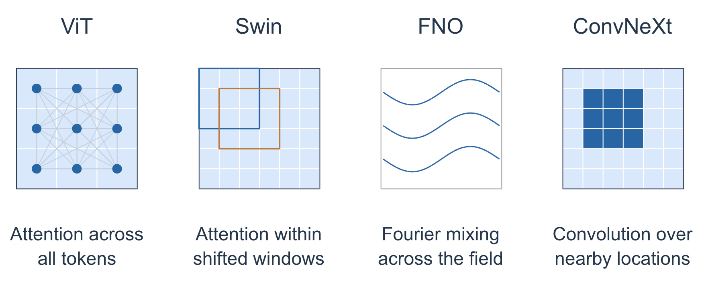

# Deep Learning at Scale - Engineering High Resolution Scientific AI models (SC26)

The tutorial trains image-to-image models on high-resolution fields: the same kind of data used in scientific applications such as weather and climate, fluid dynamics, seismology, cosmology, and experimental imaging. Every run in this repository uses 4096 × 4096 inputs from an example turbulence simulation. We start from a single GPU, speed up data loading and compute, then scale with data parallelism and with model parallelism across tensor and spatial dimensions.

We focus on four architectures that represent the general architecture space of scientific AI models. These are Vision Transformer (ViT) based for global mixing, Local attention based models like Swin Transformer for local mixing, Fourier Neural Operators (FNO) for spectral mixing, and ConvNeXt for convolution based local mixing. Since each architecture class mixes information in different ways, we will see how this affects performance and scaling. 




**Contents**

* [Links](#links)
* [Setup](#setup)
* [Models and data](#models-and-data)
* [Configuration](#configuration)
* [Single-GPU training](#single-gpu-training)
* [Single-GPU performance](#single-gpu-performance)
* [Data parallelism](#data-parallelism)
* [Model parallelism](#model-parallelism)

## Links

Tutorial slides: https://drive.google.com/drive/folders/14OJ1mMEzsYa1MC2G2jfXJZpbE_HxoKzh?usp=sharing

Join the Slack workspace:

## Setup

Clone the repository and work from the top-level directory:

```bash
git clone https://github.com/NERSC/sc26-dl-tutorial.git
cd sc26-dl-tutorial
```

Training is launched with the Slurm scripts in the repository root:

| Script | What it runs | How the GPUs are requested |
|---|---|---|
| [`submit_pm.sh`](submit_pm.sh) | [`train.py`](train.py) | one GPU per task (`sbatch -n 1` for a single GPU) |
| [`submit_pm_dp.sh`](submit_pm_dp.sh) | [`train.py`](train.py) | 4 tasks per node (`sbatch -N <nodes>`) |
| [`submit_pm_mp.sh`](submit_pm_mp.sh) | [`train_mp.py`](train_mp.py) | 4 tasks per node (`sbatch --nodes=<nodes>`) |

Each script starts the tutorial container, mounts the dataset at `/data`, and mounts the log directory at `/logs`. Override the host paths with `DATADIR` and `LOGDIR`:

```bash
DATADIR=/path/to/data LOGDIR=/path/to/logs sbatch -n 1 ./submit_pm.sh --config=short
```

Anything after the script name is forwarded to the training program. Slurm writes the job output to a `.out` file in the directory you submitted from. `squeue --me` lists your job id.

Profiles are captured with [Nsight Systems](https://developer.nvidia.com/nsight-systems). Install the host build for your laptop so you can open the `.nsys-rep` files the jobs write into `LOGDIR`. The download is on the [NVIDIA developer site](https://developer.nvidia.com/gameworksdownload#?search=nsight%20systems) (Linux, Windows, or macOS). An NVIDIA developer account is required for the download.

## Models and data

All four networks map an input field to a later field. The implementation for each one is a serial module used by [`train.py`](train.py) and a distributed module used by [`train_mp.py`](train_mp.py).

| Model | What mixes the field | Serial | Distributed |
|---|---|---|---|
| ViT | Attention across all patch tokens | [`networks/vit.py`](networks/vit.py) | [`networks/vit_mp.py`](networks/vit_mp.py), and [`networks/vit_te.py`](networks/vit_te.py) for Transformer Engine |
| Swin | Attention inside shifted windows | [`networks/swin.py`](networks/swin.py) | [`networks/swin_mp.py`](networks/swin_mp.py) |
| FNO | A spectral convolution over the whole grid | [`networks/fno.py`](networks/fno.py) | [`networks/fno_mp.py`](networks/fno_mp.py) |
| ConvNeXt | A depthwise convolution over nearby cells, then a channel MLP | [`networks/convnext.py`](networks/convnext.py) | [`networks/convnext_mp.py`](networks/convnext_mp.py) |

The ViT and Swin embed the image as patches and run transformer blocks. The ViT attends over the full token sequence. Swin attends inside windows and shifts those windows on alternate blocks, so each layer only sees a local neighborhood and later layers grow the receptive field. The FNO stays on the grid: each block applies a 2D FFT, mixes channels at the retained wavenumbers, and transforms back. ConvNeXt also stays at constant resolution. A patch stem lifts the field, depthwise convolutions mix neighbors, and a pointwise MLP mixes channels.

The hands-on path below uses the ViT configs in [`config/ViT.yaml`](config/ViT.yaml). The same scripts train the other three networks by pointing `--yaml_config` at their file. See [Configuration](#configuration).

The dataset is a set of synthetic trajectories stored as HDF5. Each file holds a time series of 4096 × 4096 fields with 2 channels. A sample is a pair of snapshots separated by `dt` steps: the network sees the first and is trained to predict the second. Channel mean and standard deviation come from `stats_trajectory.h5`. Files are split 90 / 10 into training and validation.

[`utils/data_loader.py`](utils/data_loader.py) is the PyTorch loader (`SynDataset` plus `DataLoader`). [`utils/data_loader_dali.py`](utils/data_loader_dali.py) is the DALI loader. `data_loader_config` in the YAML file selects which one is built. When the run is distributed, samples are partitioned across the data-parallel ranks. `spatial_read_mode` controls spatial sharding: `local` reads one rank's tile of each image, and `all` reads the full image and slices it afterward.

[`train.py`](train.py) and [`train_mp.py`](train_mp.py) then:

1. Build the network named by the config, an Adam optimizer, and a mean-squared-error loss.
2. Step through batches: copy the batch to the GPU, run the forward pass, call `backward()`, and update the weights.
3. Evaluate on the validation set and write scalars for TensorBoard: training loss, validation loss, RMSE of the first output channel, learning rate, and samples per second.

The learning rate follows a cosine decay over `num_iters` steps (`CosineAnnealingLR`). A config with `warmup` greater than 0 uses `LambdaLR` so the rate rises linearly for that many steps and then follows the same cosine.

NVTX ranges mark data copy, forward, and the optimizer step. On the fourth epoch (epoch index 3) the scripts call `torch.cuda.profiler.start()` and `stop()`, which is the window Nsight Systems records. A profiled config needs at least four epochs.

## Configuration

A run is selected with two arguments. The submission scripts forward them unchanged:

```text
--yaml_config PATH    # which file, default ./config/ViT.yaml
--config NAME         # which named config in that file, default base
```

[`train.py`](train.py) also accepts `--run_num` and `--expdir`. [`train_mp.py`](train_mp.py) adds the mesh:

```text
--tp     tensor-parallel size, default 1
--sp1    first spatial dimension, default 1
--sp2    second spatial dimension, default 1
--order  rank placement, default tp-sp1-sp2-dp
```

Every other setting is a key in the YAML file. The files use anchors, so a named config inherits from another and lists only what it changes.

| File | Network | Named configs |
|---|---|---|
| [`config/ViT.yaml`](config/ViT.yaml) | ViT (`network` omitted; the default) | `base`, `short`, `short_opt`, `short_opt_dali`, `short_opt_dali_dp`, `short_opt_big`, `opt_big`, `short_mp`, `short_mp_te` |
| [`config/swin.yaml`](config/swin.yaml) | Swin (`network: swin`) | `base`, `short`, `short_opt`, `opt`, `mp` |
| [`config/FNO.yaml`](config/FNO.yaml) | FNO (`network: fno`) | `base`, `short`, `short_opt`, `opt`, `mp`, `mp_resample`, `mp_vit_matched`, `embed_large` |
| [`config/ConvNeXt.yaml`](config/ConvNeXt.yaml) | ConvNeXt (`network: convnext`) | `small`, `big` |

Shared keys cover the image (`img_size`, `n_in_channels`, `n_out_channels`), the optimization (`global_batch_size`, `lr`, `num_iters`, `amp_mode`, `enable_fused`, `enable_jit`), and the loader (`data_loader_config`, `num_data_workers`, `spatial_read_mode`, `limit_nsamples`, `limit_nsamples_val`). Model keys differ:

| Network | Model keys |
|---|---|
| ViT | `embed_dim`, `depth`, `num_heads`, `patch_size`, `dropout`, `model_backend` (`pytorch` or `transformer-engine`) |
| Swin | `embed_dim`, `depth`, `num_heads`, `patch_size`, `window_size`, `dropout` |
| FNO | `embed_dim` (hidden channels), `depth`, `modes_kh` and `modes_kw` (retained wavenumbers; `None` keeps all), `mlp_ratio` (width of the channel MLP; `0` disables it), `downsample` (Fourier coarsening of the grid the blocks run on), `lift_dim`, `resample_skip` |
| ConvNeXt | `embed_dim`, `depth`, `patch_size`, `kernel_size`, `layer_scale_init` |

The number of tokens in ViT and Swin is `(4096 / patch_size)^2`. For any distributed run:

```text
world_size = dp * tp * sp1 * sp2
local_batch_size = global_batch_size / dp
```

`dp` is whatever is left after the model-parallel flags claim their GPUs. `global_batch_size` has to be divisible by `dp`.

### ViT path through the tutorial

The sections below follow this sequence. Image size is 4096 × 4096 and the head count is 16 throughout.

| Stage | Config | GPUs and mesh | What changes |
|---|---|---|---|
| Baseline | `short` | 1 GPU | FP32, PyTorch loader, 0 workers. 64 training samples, 16 validation samples, 80 iterations. ViT is embed 512, depth 12, patch 32 (16,384 tokens). Global batch 4. |
| Single-GPU optimizations | `short_opt` | 1 GPU | 2 loader workers, BF16, `torch.compile`, fused Adam. Same samples and same model. |
| DALI | `short_opt_dali` | 1 GPU | Same as `short_opt`, with the DALI loader. |
| Data parallel | `short_opt_dali_dp` | 4 GPUs, `dp=4` | Same model and optimizations. Global batch 16, so the local batch stays 4. |
| Larger model, data parallel | `short_opt_big` | 16 GPUs, `dp=16` | Patch 16 and embed 1024 (65,536 tokens). Global batch 16, local batch 1. |
| Spatial parallel | `short_mp` | 16 GPUs, `dp=4`, `sp1=4` | Embed 1536, depth 16, patch 16. Global batch 4, local batch 1. Compilation off. |
| Transformer Engine | `short_mp_te` | 16 GPUs, `dp=4`, `sp1=4` | Same model as `short_mp`, built with Transformer Engine. |

`base` and `opt_big` are the long versions of `short` and `short_opt_big` (`num_iters: 30000`). Use the `short*` configs in the session.

### Other networks

Swin uses the same patch-and-window idea with a local attention pattern. `window_size` has to divide the patch grid owned by each spatial rank, so a mesh that splits a window in half will fail when the model is built. Launch the short single-GPU config with:

```bash
sbatch -n 1 ./submit_pm.sh --yaml_config ./config/swin.yaml --config short
```

The FNO runs at the full grid resolution in every block, so activation memory scales with `embed_dim` times the number of grid points. The single-GPU configs use `embed_dim: 16` and a global batch of 1. Its spectral weights are complex, so the configs leave fused Adam off and use BF16 when mixed precision is on: FP16 loss scaling does not support those parameters. Spatial parallelism shards height across `sp1` and width across `sp2`, and the distributed FFT transposes between those axes. The configs use `--tp=1`: the spectral weights are small beside the activation traffic, and the transposes already move the field. The channel count has to be at least `sp1` and at least `sp2`, because those transposes also split channels. `downsample` greater than 1 runs the blocks on a coarser latent grid (`mp_resample`, `mp_vit_matched`, `embed_large`).

```bash
# one GPU
sbatch -n 1 ./submit_pm.sh --yaml_config ./config/FNO.yaml --config short

# 16 GPUs: dp=4, a 2x2 spatial tile
sbatch --nodes=4 ./submit_pm_mp.sh --yaml_config ./config/FNO.yaml --config mp --tp=1 --sp1=2 --sp2=2 --run_num=fno_sp2x2
```

ConvNeXt replicates its weights and exchanges a halo of neighboring cells before each depthwise convolution. The distributed model supports data and spatial parallelism with `--tp=1`. `small` matches the ViT baseline width (patch 32, embed 512, depth 12, global batch 4). `big` matches the large ViT (patch 16, embed 1536, depth 16).

```bash
sbatch -n 1 ./submit_pm.sh --yaml_config ./config/ConvNeXt.yaml --config small --run_num=convnext_small

# 8 GPUs: dp=2, sp1=4, local batch 2, global batch 4
sbatch --nodes=2 ./submit_pm_mp.sh --yaml_config ./config/ConvNeXt.yaml --config big --tp=1 --sp1=4 --sp2=1 --run_num=convnext_big
```

Prefer a height-only split (`sp2=1`) when `spatial_read_mode` is `local`, so each rank reads a contiguous block of complete rows. Layouts that also split width are set up for `spatial_read_mode: all`.

### Writing a new config

Copy a named config and change the keys you care about:

```yaml
# in config/ViT.yaml
my_vit:
  <<: *short_opt
  embed_dim: 768
  num_iters: 80
```

```bash
sbatch -n 1 ./submit_pm.sh --yaml_config ./config/ViT.yaml --config my_vit
```

A new file needs the same data, training, and communication keys as the existing ones, plus the model keys for the network.

Two paths decide where files land. The submission scripts mount `LOGDIR` at `/logs` inside the container. The config key `expdir` (default `/logs`) is a path inside the container, so it has to sit under a mounted directory. `--expdir /logs/runs_a` writes to `runs_a` under `LOGDIR` and overrides the config for that job.

[`train.py`](train.py) writes to `<expdir>/<config>/<N>GPU/<run_num>/`. [`train_mp.py`](train_mp.py) writes to `<expdir>/<config>/<M>MP/<run_num>/`, where `M` is `tp * sp1 * sp2`. The directory name uses the config name only, and several files reuse names such as `short` and `mp`. Set `--run_num` when two runs would otherwise share a directory.

## Single-GPU training

The baseline is the `short` config: one GPU, FP32, the PyTorch loader, and no extra workers. Submit it with:

```bash
sbatch -n 1 ./submit_pm.sh --config=short
```

The job trains the ViT in the table above for 80 iterations. Logs, TensorBoard event files, and `out.log` are written under `LOGDIR/short/1GPU/00/`.

Open [`start_tensorboard.ipynb`](start_tensorboard.ipynb) and point it at `LOGDIR` to plot the scalars the training loop records.

> **TODO:** baseline training curve (loss, validation RMSE, samples/sec) for `short`.

## Single-GPU performance

`short` is the reference point for the optimizations. The loader runs inside the training process (`num_data_workers: 0`), and the compute runs in FP32.

> **TODO:** throughput after the first epoch for `short`, and the Nsight Systems timeline (zoomed out, and one iteration).

### Capturing a profile

`train.py` already has NVTX ranges around the batch copy, the forward pass, and the optimizer step, and it enables the CUDA profiler for the fourth epoch. Turn on capture in the job script with:

```bash
ENABLE_PROFILING=1 PROFILE_OUTPUT=short sbatch -n 1 ./submit_pm.sh --config=short
```

The script wraps the process in `nsys profile` and writes one report per rank to `LOGDIR`. The name is `PROFILE_OUTPUT` plus the Slurm rank, so this command produces `short.<rank>.nsys-rep`. Copy the report locally and open it in Nsight Systems. The same `ENABLE_PROFILING=1` prefix works on the data-parallel and model-parallel scripts.

### Loader workers, BF16, compilation, and fused Adam

`short_opt` keeps the PyTorch loader and turns on the single-GPU optimizations together:

* `num_data_workers: 2` loads batches in side processes. `pin_memory` is already set in the loader, so the host copy uses pinned memory.
* `amp_mode: bf16` runs eligible ops in BF16 under `torch.autocast`. BF16 keeps the FP32 exponent range, so the loss is used as computed. `amp_mode: fp16` scales the loss through `GradScaler`.
* `enable_jit: true` wraps the model in `torch.compile`.
* `enable_fused: true` uses the fused Adam kernel, which applies the update in fewer launches.

```bash
sbatch -n 1 ./submit_pm.sh --config=short_opt --run_num=opt
ENABLE_PROFILING=1 PROFILE_OUTPUT=short_opt sbatch -n 1 ./submit_pm.sh --config=short_opt --run_num=opt_profile
```

> **TODO:** throughput for `short_opt`, and the Nsight Systems timeline.

### DALI

`short_opt_dali` is `short_opt` with `data_loader_config: dali`. DALI runs its workers in its own runtime and can copy the next batch on a separate CUDA stream while the model runs.

```bash
sbatch -n 1 ./submit_pm.sh --config=short_opt_dali --run_num=dali
ENABLE_PROFILING=1 PROFILE_OUTPUT=short_opt_dali sbatch -n 1 ./submit_pm.sh --config=short_opt_dali --run_num=dali_profile
```

> **TODO:** throughput for `short_opt_dali`, and the timeline showing the DALI streams overlapping the training step.

On the GPUs used for the tutorial, FP32 GEMMs already use TF32 tensor-core math. `NVIDIA_TF32_OVERRIDE=0` turns that off if you want a pure FP32 measurement of the baseline.

## Data parallelism

`DistributedDataParallel` replicates the model on each GPU and all-reduces gradients during the backward pass. The implementation here uses the NCCL backend and one process per GPU. [`export_DDP_vars.sh`](export_DDP_vars.sh), sourced by the job scripts, publishes `RANK`, `LOCAL_RANK`, and `WORLD_SIZE` from Slurm. [`train.py`](train.py) reads those and calls `torch.distributed.init_process_group`.

Each rank trains on `global_batch_size / world_size` samples. The PyTorch loader uses `DistributedSampler` in [`utils/data_loader.py`](utils/data_loader.py) so ranks see different samples. After the model is built it is wrapped as:

```python
model = DistributedDataParallel(model, device_ids=[local_rank])
```

The wrapper broadcasts the initial weights and overlaps gradient communication with the backward pass.

*Why one process per GPU, rather than one process per node that owns all four GPUs?*

*Why does DDP broadcast the initial weights? What would training do if each rank kept its own initialization?*

The 4-GPU run keeps the optimized ViT from `short_opt_dali` and scales the global batch from 4 to 16, so the local batch stays 4:

```bash
sbatch -N 1 ./submit_pm_dp.sh --config=short_opt_dali_dp --run_num=dp4
```

`short_opt_big` is the larger ViT (patch 16, embed 1024) trained with data parallelism on 16 GPUs. The global batch is 16, so each GPU holds one sample:

```bash
sbatch -N 4 ./submit_pm_dp.sh --config=short_opt_big --run_num=dp16
```

The learning rate is the `lr` value in the YAML file. Edit it in a copied config to try a larger rate with a larger batch.

*If the learning rate stays fixed while the global batch grows, what do you expect to happen to the loss curve?*

*Which of these runs finishes a fixed number of samples in the least time, and which uses the least GPU-time?*

Compare the runs in TensorBoard. The event files live under `LOGDIR/<config>/<N>GPU/<run_num>/logs/`. Switching the horizontal axis to relative time makes the throughput difference visible.

> **TODO:** samples/sec for `short_opt_dali_dp` and `short_opt_big`, and the validation-RMSE comparison against relative time.

Profile the 4-GPU run the same way as the single-GPU jobs. In the timeline, find the gradient all-reduces and see whether they overlap the backward compute:

```bash
ENABLE_PROFILING=1 PROFILE_OUTPUT=dp4 sbatch -N 1 ./submit_pm_dp.sh --config=short_opt_dali_dp --run_num=dp4_profile
```

> **TODO:** Nsight Systems timeline for the 4-GPU run, zoomed to the gradient synchronization.

*If the code called `all_reduce` on the gradients once, after the backward pass, instead of using DDP, what would that timeline look like?*

## Model parallelism

Data parallelism replicates the whole model and the whole image on every GPU. A wider network, or the same network on this 4096 × 4096 grid with smaller patches, stores more activations than one GPU holds. Model parallelism splits that state. The ViT in [`networks/vit_mp.py`](networks/vit_mp.py) is the worked example; the other networks call the same primitives.

### Communicator groups

Treat the allocation as an `M × D` grid. `D` GPUs replicate the model, as in the data-parallel section, and `M` GPUs split one replica. [`utils/comm.py`](utils/comm.py) factors `M` further, into tensor parallelism and two spatial axes:

```text
world size = dp × tp × sp1 × sp2
```

`dp` is orthogonal to the model-parallel axes. The ViT folds `sp1 × sp2` into one context-parallel group, `sp1-sp2`. Swin, the FNO, and ConvNeXt keep `sp1` and `sp2` as separate spatial axes.

`comm.init` asks [`utils/rank_generator.py`](utils/rank_generator.py) for the rank list of each group, then registers that list with `torch.distributed.new_group`. A collective takes the group it should run on:

```python
torch.distributed.all_reduce(tensor, group=comm.get_group("tp"))
```

Ranks absent from a list are not members of that group. `comm.get_group`, `comm.get_rank`, and `comm.get_size` are the lookups the layers use.

`order` chooses which index varies fastest. The default `tp-sp1-sp2-dp` makes tensor-parallel ranks a contiguous block, so they share a node. [`utils/check_rank_generator.ipynb`](utils/check_rank_generator.ipynb) prints the lists for any mesh.

Eight GPUs with `tp=4` and `dp=2` give tensor-parallel groups `[0, 1, 2, 3]` and `[4, 5, 6, 7]`, and data-parallel groups `[0, 4]`, `[1, 5]`, `[2, 6]`, `[3, 7]`. Rank 5 exchanges activations inside `[4, 5, 6, 7]` and reduces data-parallel gradients with rank 1.

Only `dp` changes which sample a rank reads. [`train_mp.py`](train_mp.py) sizes the loader from that group, so a model-parallel group trains on one example and each rank keeps its piece of it:

```python
params.data_num_shards = comm.get_size("dp")
params.data_shard_id = comm.get_rank("dp")
```

### Autograd mappings

A layer that communicated in the forward has to communicate the matching quantity in the backward. PyTorch will not infer that pair. Each one is a `torch.autograd.Function` in [`distributed/mappings.py`](distributed/mappings.py): `forward` runs one collective, `backward` runs its adjoint. The modules call the wrappers (`identity_forward_allreduce_backward`, and the others below) rather than `all_reduce` directly, so both directions stay defined.

The ViT MLP is the Megatron split, as `ColumnParallelLinear` and `RowParallelLinear`.

A column-parallel layer stores a slice of the output features and sees the full input. The matmul is local, so the forward collective is an identity. On the way back, each rank holds only a partial input-gradient, and the full gradient is their sum. The layer calls `identity_forward_allreduce_backward(x, "tp")` on its input. Attention uses the same layer for the query, key, and value projections, which also splits the heads across `tp`.

A row-parallel layer stores a slice of the input features. Each matmul is a partial output and the real output is the sum, so the forward ends in `allreduce_forward_identity_backward(x, "tp")`. The output-gradient arriving in the backward is already complete, and that pass stays local. The attention projection and the second MLP matrix are row-parallel.

Sequence sharding is the same pattern on the token axis. Attention leaves the query on the local tokens and gathers keys and values over `sp1-sp2` with `allgather_forward_reducescatter_backward`. The backward reduce-scatters the key and value gradients onto the tokens that owned them. `allgather_forward_split_backward` and `split_forward_allgather_backward` are the gather/split pair for a tensor that is cut without a reduction.

The other networks call the same kind of function. The FNO's FFT uses `distributed_transpose`: an all-to-all that swaps which axis is sharded, with the inverse transpose in the backward. ConvNeXt uses `halo_forward_sum_backward`, which copies neighbor edges in and, on the way back, returns the halo gradients to the rank that owns those cells. Swin's window shift uses `roll_forward_reverseroll_backward`.

A parameter that is a slice or a copy across a group carries `comm_metadata`. `init_ddp_model_and_reduction_hooks` in the same file reads it when the model is wrapped in DDP, and adds an all-reduce for any weight gradient the local backward has not already summed. A column-parallel weight, updated from this rank's tokens and copied across the spatial group, is marked:

```python
self.weight.comm_metadata = {
    "sharded": ["tp", None],
    "shared": ["sp1-sp2"],
    "reduce": ["sp1-sp2"],
}
```

`sharded` is the axis of the slice, `shared` is a group holding an identical copy, and `reduce` is that extra all-reduce.

### Running the large ViT

`short_mp` is the embed-1536, depth-16, patch-16 ViT, with global batch 4. The suggested mesh puts 4 GPUs on the sequence (`sp1=4`) and 4 on the batch (`dp=4`), which is 16 GPUs:

```bash
sbatch --nodes=4 ./submit_pm_mp.sh --config=short_mp --tp=1 --sp1=4 --sp2=1 --run_num=sp4
```

The same config with the split moved onto tensor parallelism:

```bash
sbatch --nodes=4 ./submit_pm_mp.sh --config=short_mp --tp=4 --sp1=1 --sp2=1 --run_num=tp4
```

`order=tp-sp1-sp2-dp` is the default. For a spatial-heavy mesh, `--order=sp1-tp-sp2-dp` keeps the spatial ranks adjacent.

> **TODO:** memory after the forward pass, and samples/sec, for `sp4` and `tp4`.

> **TODO:** Nsight Systems timeline for `sp4`, zoomed to the activation collectives in forward and backward, and the DDP gradient buckets.

*Which activations does `sp1=4` leave replicated on every rank? Which weights does `tp=4` leave replicated?*

### Transformer Engine

The ViT is a stack of attention and MLP blocks on a 1D token sequence, so the same mesh can be built from [Transformer Engine](https://docs.nvidia.com/deeplearning/transformer-engine/user-guide/index.html) layers. `short_mp_te` sets `model_backend: transformer-engine`. [`networks/vit_te.py`](networks/vit_te.py) passes the tensor-parallel group into `te.Linear` and `te.DotProductAttention`; TE shards the weights and inserts the collectives. Swin, FNO, and ConvNeXt keep the custom modules above, which implement the collectives those layouts use.

```bash
sbatch --nodes=4 ./submit_pm_mp.sh --config=short_mp_te --tp=1 --sp1=4 --sp2=1 --run_num=sp4_te
```

TE's context parallelism expects the local sequence lengths to be even. [`networks/vit_te.py`](networks/vit_te.py) pads a local sequence when the `sp1 × sp2` split does not already satisfy that.

> **TODO:** memory and samples/sec for `short_mp_te` next to the native `short_mp` run.

> **TODO:** Nsight Systems timeline for the Transformer Engine run, with the TE NVTX ranges visible around one MLP or attention block.

### CUDA graphs

[`train_mp_graphs.py`](train_mp_graphs.py) is the same model-parallel loop with the step captured in a CUDA graph. Graphs remove the CPU launch overhead between kernels, which shows up when a step is many small launches or when several communicators have to stay in step. [`submit_pm_mp.sh`](submit_pm_mp.sh) calls [`train_mp.py`](train_mp.py). Compare the two training scripts to see where the graph is captured and replayed.

> **TODO:** timeline comparing `train_mp.py` and `train_mp_graphs.py` on the same mesh.
