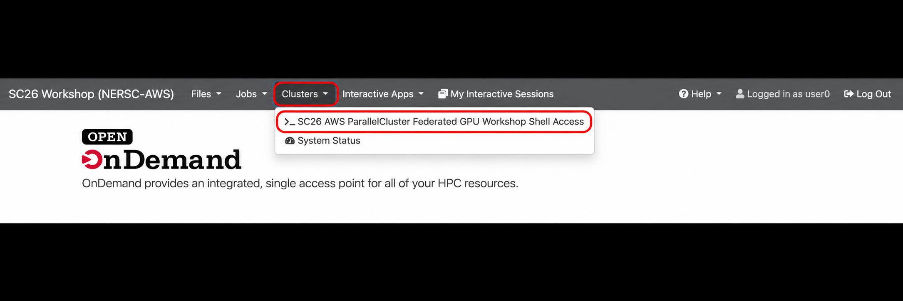
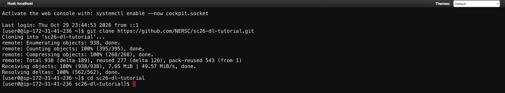
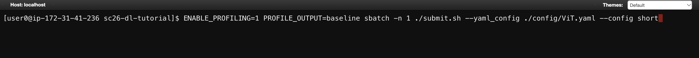
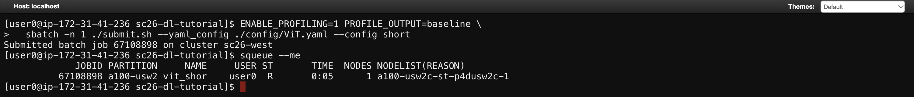
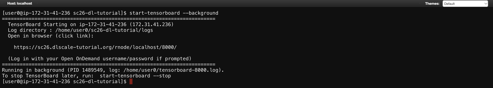
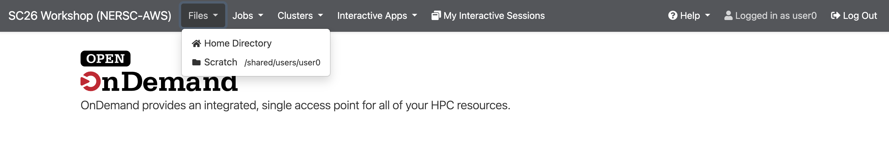
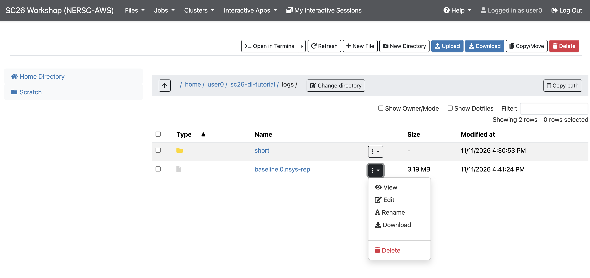

# Getting started on the tutorial cluster

## 1. Request an account

Fill out the [account request form](https://docs.google.com/forms/d/e/1FAIpQLSdczA3y-uor1s-gfLBQvLbxlNBJRasYt0j5sFaIiLhU8zbmIQ/viewform) to request a username and password for the tutorial.

## 2. Log in

Once you have your username and password, go to [sc26.dlscale-tutorial.org](https://sc26.dlscale-tutorial.org/) and sign in with those credentials.

## 3. Open a terminal

In the top menu, click **Clusters**, then **SC26 AWS ParallelCluster Federated GPU Workshop Shell Access** to open a terminal.



## 4. Clone the tutorial repository

In the browser terminal, copy and paste these commands to download the tutorial code and enter its directory:

```bash
git clone https://github.com/NERSC/sc26-dl-tutorial.git
cd sc26-dl-tutorial
```

After the download finishes and you change directories, the terminal prompt shows `sc26-dl-tutorial`, as in the screenshot below.



## 5. Submit a job

Submit jobs using `sbatch` and the provided submission scripts. From the `sc26-dl-tutorial` directory, run the example below to start the single-GPU ViT baseline (`short`), the first run in the [ViT single-GPU walkthrough](vit/single-gpu.md#profiling):

```bash
ENABLE_PROFILING=1 PROFILE_OUTPUT=baseline \
sbatch -n 1 ./submit.sh --yaml_config ./config/ViT.yaml --config short
```

This uses [`submit.sh`](../submit.sh) to run training on one GPU, with Nsight Systems profiling enabled. Press **Enter** to submit the job.



## 6. Check your job's status

After submission, Slurm prints a job ID. To see your jobs and their current status, run:

```bash
squeue --me
```

The `JOBID` column identifies each job. The `ST` column shows its state:

| State | Meaning |
|---|---|
| `R` | **Running**: the job has been allocated resources and is running. |
| `PD` | **Pending (queued)**: the job is waiting to start, for example until resources become available. |

For a running job, `TIME` shows the elapsed runtime and `NODELIST(REASON)` lists the allocated nodes. For a pending job, `NODELIST(REASON)` shows why it is waiting. See the [Slurm documentation](https://slurm.schedmd.com/squeue.html#SECTION_JOB-STATE-CODES) for other states.

In this example, job `67108898` has state `R` and has been running for five seconds on one node.



### Read the output log

You can read the job's output log while it is running. From the repository directory, use `cat` to display the output written so far:

```bash
cat vit_short_67108898.out
```

Replace the example filename with your job's output filename. Run the command again to see new output as training progresses.

### Cancel jobs

To cancel one queued or running job, use `scancel` with its job ID. Replace `JOB_ID` with the number shown by `squeue --me`:

```bash
scancel JOB_ID
```

To cancel **all queued and running jobs belonging to your user account**, run:

```bash
scancel --user="$USER"
```

`$USER` is your logged-in username. Run `squeue --me` again to check the queue after cancellation. See the [scancel documentation](https://slurm.schedmd.com/scancel.html) for more options.

## 7. View training metrics with TensorBoard

Use the helper provided on the tutorial cluster to start TensorBoard in the background:

```bash
start-tensorboard --background
```

The helper prints a link you can open in your browser to view the training metrics. Use the link from your own terminal output, and log in with your tutorial username and password if prompted.



By default, the helper reads logs from `$HOME/sc26-dl-tutorial/logs`. If you use a different logging directory, pass its path before `--background`. For example, the command below sets the directory explicitly; replace the path with your own:

```bash
start-tensorboard "$HOME/sc26-dl-tutorial/logs" --background
```

When you are finished, stop TensorBoard with:

```bash
start-tensorboard --stop
```

## 8. Download profiles to your computer

**Wait until your job has completed before downloading its `.nsys-rep` files.**

Download the Nsight Systems profiles (`.nsys-rep` files) to inspect them on your local computer. Return to the [cluster website](https://sc26.dlscale-tutorial.org/), click **Files**, then **Home Directory** if your logs are stored in your home directory.



Open the **sc26-dl-tutorial** folder, then **logs**. If you used a different logging directory, navigate there instead.

Find the profile you want to download, such as `baseline.0.nsys-rep`. Click the **three-dot menu** beside that file, then **Download** to save it to your local computer.



Open the downloaded `.nsys-rep` file in Nsight Systems on your computer to explore the profile.
