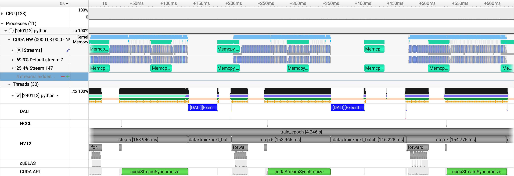
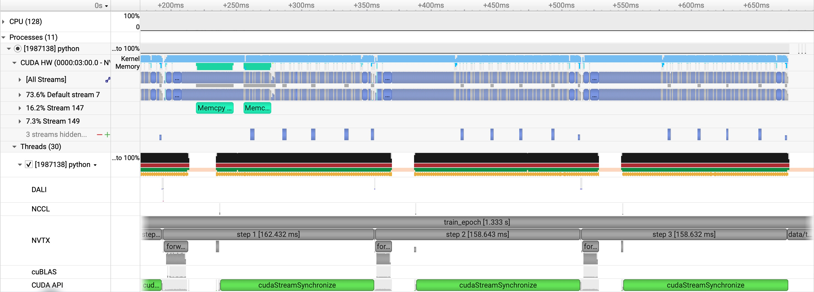

# ConvNeXt: data parallelism

[Tutorial](../../README.md) · [Single GPU](single-gpu.md) · [Spatial parallel](model-parallel.md) · [Runbook](../RUNBOOK.md#convnext)

Each GPU holds the full patch-32, width-512, depth-12, kernel-7 ConvNeXt and
receives different samples. [train.py](../../train.py) uses
DistributedDataParallel to average gradients. Keep the optimized single-GPU
settings: BF16 autocast, fused Adam, compilation, and DALI with four workers.

| Config | Nodes / GPUs | Local / global train batch | Learning rate | Train / validation batches per epoch | Updates for 5 epochs |
|---|---|---|---|---|---|
| `short_opt_dali` | 1 / 1 | 4 / 4 | `5e-4` | 64 / 8 | 320 |
| `short_opt_dali_dp4` | 1 / 4 | 4 / 16 | `1e-3` | 16 / 2 | 80 |
| `short_opt_dali_dp16` | 4 / 16 | 4 / 64 | `2e-3` | 4 / 2 | 20 |

The learning rate is `5e-4 * sqrt(global_batch / 4)`: factors 2 and 4 at
global batches 16 and 64. Each run covers five scheduled epochs, with a cosine
learning-rate schedule over the listed number of updates.

The 1- and 4-GPU runs validate on 32 samples. The 16-GPU config uses 128 so
each rank has two validation batches of 4.

## Scaling

Recorded performance, leaving out epoch 1 and the profiled epoch:

| GPUs | Global batch | Throughput (samples/sec) | GPU memory after forward (GB) |
|---|---|---|---|
| 1 | 4 | 11.26 | 23.129 |
| 4 | 16 | 59.97 | 23.256 |
| 16 | 64 | 170.82 | 22.834 |

The trainer reports global throughput. Memory stays close to the single-GPU
run because each GPU still holds the same model and local batch of four.

## Four GPUs

Profile: `convnext_dp4.0.nsys-rep`. Gradient synchronization adds NCCL calls
during backward. Training and validation complete all five epochs, with
validation loss falling from 0.2786 to 0.1238.

## Sixteen GPUs

`short_opt_dali_dp16` reaches 170.82 samples/sec, 2.85× the four-GPU rate.
Each rank runs four training steps per epoch. The visible steps in
`convnext_dp16.0.nsys-rep` are closely packed, at about 159–162 ms each.

This run also completes five epochs of training and validation. Validation
loss falls from 0.4162 to 0.2585. The larger global batch makes fewer optimizer
updates over the same training samples, and this run uses the larger validation
set described above.

The [runbook](../RUNBOOK.md#convnext) has the submission commands and output
paths. Continue with [spatial parallelism](model-parallel.md).
