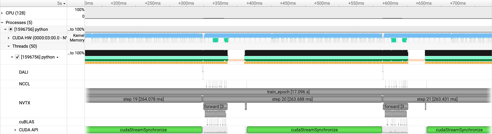
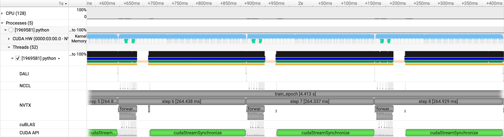

# ConvNeXt: spatial parallelism

[Tutorial](../../README.md) · [Single GPU](single-gpu.md) · [Data parallel](data-parallel.md) · [Runbook](../RUNBOOK.md#convnext)

[convnext_mp.py](../../networks/convnext_mp.py) splits feature maps across
spatial tiles. Weights, gradients, and optimizer states remain replicated.
`tp=1` is required: this ConvNeXt does not implement tensor parallelism. Spatial
splitting reduces activation storage and the per-rank input/output tile size,
but does not divide parameter storage.

A 7×7 depthwise convolution needs a halo of three feature cells. Each block
exchanges width stripes (`sp2`), then height stripes (`sp1`), including the
corners. Global edges keep the serial model's zero padding. Backward returns
and sums the halo gradients. The channel MLP and normalization stay local;
weight gradients are summed across spatial ranks and averaged across replicas.

## A larger model

`short_mp` uses patch 16, width 768, depth 12, kernel 7, BF16, fused Adam,
DALI with two workers, and eager execution. The feature grid is 256×256.
The batch is 4, with 256 training and 32 validation samples. `num_iters: 320`
schedules five epochs.

Both the unsharded and spatial runs use [train_mp.py](../../train_mp.py).
On one GPU, `tp=1, sp1=1, sp2=1` keeps the complete field on the device.
On four GPUs, `tp=1, sp1=4, sp2=1` gives each rank a 64×256 feature tile.
Both runs have one DP replica and the same batch of four samples.

## No split

The unsharded run builds the model, then runs out of memory in the channel
MLP's first linear layer during the training forward pass. It does not
complete an epoch. The relevant lines from `convnext_unsplit-61122753.out` are:

```text
    x = self.fc1(x)
    ...
    return F.linear(input, self.weight, self.bias)
torch.OutOfMemoryError: CUDA out of memory. Tried to allocate 1.50 GiB.
```

## Four-way spatial split

`sp1=4` fits the same model and batch on four GPUs of one node. It completes all
five epochs of training and validation. The local parameter count remains
57.948 M, because spatial splitting keeps the weights replicated.

Recorded performance, leaving out epoch 1 and the profiled epoch:

- GPU memory: 27.561 GB after the forward pass.
- Throughput: 15.12 samples/sec across 4 GPUs.
- Validation loss: 0.1449 in epoch 1, falling to 0.0493 in epoch 5.

The steps in `convnext_sp4.0.nsys-rep` are about 264 ms and sit next to one
another. The NCCL row shows the repeated calls during the forward for halo
exchange, followed by communication during backward.



## Four replicas across two nodes

`short_mp_dp4` keeps the same model and `tp=1, sp1=4, sp2=1`. Sixteen GPUs
leave `dp=4`: four replicas, each split across four GPUs of a node. Local batch stays 4
and global batch becomes 16. The learning rate is `1e-3`, from
`5e-4 * sqrt(16 / 4)`. There are 16 training and 2 validation batches per epoch,
so `num_iters: 80` schedules five epochs.

The default rank order, `tp-sp1-sp2-dp`, keeps each spatial group within one
node. The trainer infers DP size from world size and the spatial mesh.

Recorded performance, leaving out epoch 1 and the profiled epoch:

- GPU memory: 26.725 GB after the forward pass.
- Throughput: 57.65 samples/sec across 16 GPUs.
- Validation loss: 0.2241 in epoch 1, falling to 0.1131 in epoch 5.

The four replicas give a 3.81× throughput increase over one replica, or
95.3% scaling efficiency. Training and validation complete all five epochs.
The local parameter count is still 57.948 M.

In `convnext_sp4_dp4.0.nsys-rep`, the steps remain about 264 ms and have
little space between them. Each replica keeps its spatial exchanges within
one node; gradient synchronization also connects the four replicas.



The [runbook](../RUNBOOK.md#convnext) has the submission commands and output paths.
