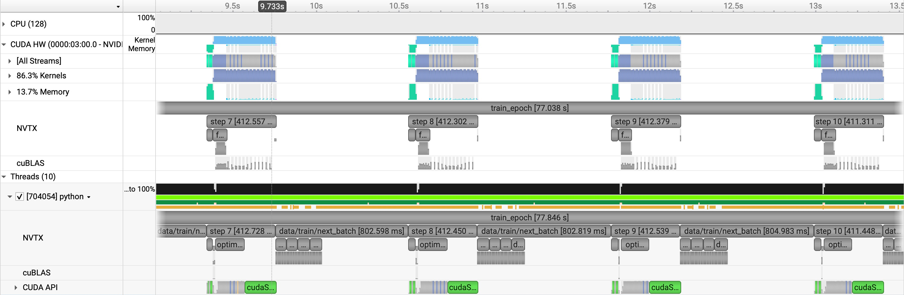
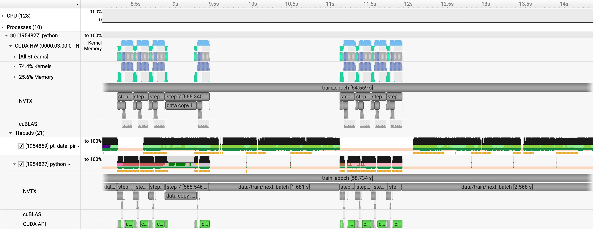
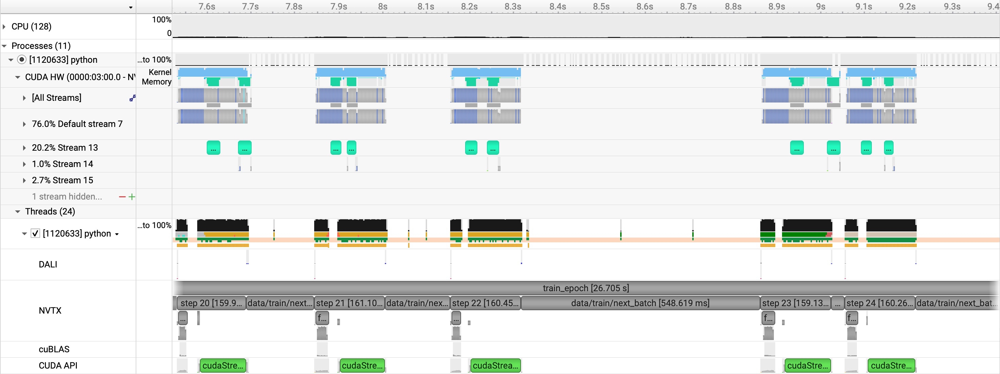

# ConvNeXt: single GPU

[Tutorial](../../README.md) · [Data parallel](data-parallel.md) · [Spatial parallel](model-parallel.md) · [Runbook](../RUNBOOK.md#convnext)

ConvNeXt mixes nearby feature cells with a depthwise convolution, then mixes
channels with an MLP. The [serial model](../../networks/convnext.py) keeps the
same feature-grid resolution through all blocks. A patch stem turns each
4096×4096, two-channel field into a 128×128 grid; the head reconstructs the
two-channel field. This implementation uses zero padding at the field boundary.

The three stages in [ConvNeXt.yaml](../../config/ConvNeXt.yaml) use patch 32,
width 512, depth 12, kernel 7, batch 4, and Adam with learning rate `5e-4`.
They follow the [Swin optimization ladder](../swin/single-gpu.md).

| Config | Precision | Loader / workers | Fused Adam | Compile | Iterations |
|---|---|---|---|---|---|
| `short` | FP32 | PyTorch / 0 | No | No | 320 |
| `short_opt` | BF16 autocast | PyTorch / 4 | Yes | Yes | 320 |
| `short_opt_dali` | BF16 autocast | DALI / 4 | Yes | Yes | 320 |

Each run uses 256 training and 32 validation samples. `num_iters: 320`
schedules five epochs.

## Profiling

`train.py` marks data loading, device transfers, the forward pass, and optimizer
updates. The ConvNeXt block adds `depthwise convolution` and `mlp` ranges, as in
ViT. The spatial model uses the same block ranges.

The first epoch includes startup and compilation. Epoch 4 is the profiled
epoch. Recorded throughput below averages epochs 2, 3, and 5, leaving out
startup and profiling. The [runbook](../RUNBOOK.md#convnext) has the submission
commands and output paths.

## FP32 baseline

`short` uses the PyTorch loader with no workers. Recorded performance:

- GPU memory: 25.793 GB after the forward pass.
- Throughput: 3.31 samples/sec.

In `convnext_short.0.nsys-rep`, each step takes about 412 ms, followed by
roughly 800 ms in `data/train/next_batch`. The GPU is idle during that wait.

## Workers, BF16, fused Adam, and `torch.compile`

`short_opt` enables four loader workers, BF16 autocast, fused Adam, and
compilation. Recorded performance:

- GPU memory: 16.592 GB after the forward pass, down from 25.793 GB.
- Throughput: 5.11 samples/sec, up from 3.31 samples/sec.

The compute bursts are shorter in `convnext_short_opt.0.nsys-rep`. Several
steps can run together, but long waits for the next batch still interrupt
them. Throughput varies from 4.05 to 6.28 samples/sec across the measured epochs.

## NVIDIA DALI

`short_opt_dali` keeps the optimized model settings and switches the loader
to DALI with four workers. Recorded performance:

- GPU memory: 23.129 GB after the forward pass. DALI's prefetch buffers add memory.
- Throughput: 11.26 samples/sec, up from 5.11 samples/sec.

In `convnext_short_opt_dali.0.nsys-rep`, input copies overlap GPU computation
on a separate stream. The steps are about 160 ms, but some gaps remain while
the trainer waits for the next batch.

All three runs complete five epochs of training and validation. Final
validation losses are 0.0762 (FP32), 0.0722 (optimized PyTorch loader), and
0.0731 (DALI).

Continue with [data parallelism](data-parallel.md).
