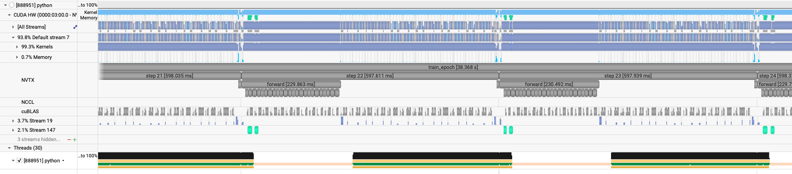

# Swin: data parallelism

[Tutorial](../../README.md) · [Single GPU](single-gpu.md) · [Model parallel](model-parallel.md)

Each GPU still holds a full copy of the Swin and a different slice of the batch. The wiring is the same as the [ViT data-parallel page](../vit/data-parallel.md): [`submit_dp.sh`](../../submit_dp.sh) runs [`train.py`](../../train.py) under `torchrun`, one process per GPU, and `DistributedDataParallel` averages the gradients. Window attention is a short step, so this page starts at the larger model with local batch 1.

## A larger model at local batch 1

`short_opt_big` uses the same size-up as the ViT: `patch_size: 16`, `embed_dim: 1024`, `depth: 12`. The patch grid is 256×256, and `window_size` 16 divides it. Global batch 4 on 4 GPUs, so the local batch is 1. Profile every rank.

```bash
ENABLE_PROFILING=1 PROFILE_OUTPUT=swin_short_opt_dali_big \
sbatch -N 1 --gpus-per-node 4 --cpus-per-task 48 ./submit_dp.sh --yaml_config ./config/swin.yaml --config short_opt_big --run_num swin_big_profile
```

Log: `$HOME/sc26-dl-tutorial/logs/short_opt_big/4GPU/swin_big_profile/out.log`.

Profiles: `swin_short_opt_dali_big.0.nsys-rep` through `swin_short_opt_dali_big.3.nsys-rep`.

The first epoch pays for `torch.compile`. Epoch 4 is the profiled epoch.

```text
2026-11-10 15:29:17,746 - root - INFO - Starting Training Loop...
2026-11-10 15:29:29,814 - root - INFO -  Memory usage after forward pass: 36.3162841796875 GB.
2026-11-10 15:30:11,202 - root - INFO - Time taken for epoch 1 is 40.171548 sec, avg 6.273097 samples/sec
2026-11-10 15:30:11,208 - root - INFO -   Avg train loss=0.300458
2026-11-10 15:30:11,218 - root - INFO -   Avg val loss=0.15853233635425568
2026-11-10 15:30:11,228 - root - INFO -   Total validation time: 2.645237445831299 sec
2026-11-10 15:30:11,985 - root - INFO -  Memory usage after forward pass: 37.0701904296875 GB.
2026-11-10 15:30:53,228 - root - INFO - Time taken for epoch 2 is 38.457580 sec, avg 6.656685 samples/sec
2026-11-10 15:30:53,234 - root - INFO -   Avg train loss=0.116468
2026-11-10 15:30:53,244 - root - INFO -   Avg val loss=0.13618680834770203
2026-11-10 15:30:53,249 - root - INFO -   Total validation time: 1.6074273586273193 sec
2026-11-10 15:30:54,004 - root - INFO -  Memory usage after forward pass: 37.3201904296875 GB.
2026-11-10 15:31:35,250 - root - INFO - Time taken for epoch 3 is 38.458148 sec, avg 6.656587 samples/sec
2026-11-10 15:31:35,255 - root - INFO -   Avg train loss=0.099881
2026-11-10 15:31:35,265 - root - INFO -   Avg val loss=0.11573591828346252
2026-11-10 15:31:35,270 - root - INFO -   Total validation time: 1.5964035987854004 sec
```

Recorded performance, leaving out epoch 1 and the profiled epoch:

- GPU memory: 37.320 GB peak after the forward pass.
- Throughput: 6.66 samples/sec across 4 GPUs, with local batch 1.

The gradient all-reduces are NCCL kernels on their own stream, issued during the backward. The larger Swin makes the step long enough that DALI hides the read, and the timeline shows no idle gap between steps.



`short_opt_big_dp16` keeps that local batch of 1 and uses 16 GPUs, so the global batch is 16. The learning rate follows the square-root rule, from `5e-4` to `1e-3`.

```bash
sbatch -N 2 ./submit_dp.sh --yaml_config ./config/swin.yaml --config short_opt_big_dp16 --run_num swin_big16
```

Log: `$HOME/sc26-dl-tutorial/logs/short_opt_big_dp16/16GPU/swin_big16/out.log`.

After the first epoch the run holds 25.6 samples/sec, up from 6.66 on 4 GPUs. The forward peaks at 36.142 GB.

The next page splits the replica: [Model parallelism](model-parallel.md).
