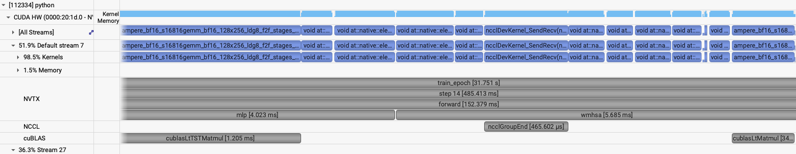

# Swin: model parallelism

[Tutorial](../../README.md) · [Single GPU](single-gpu.md) · [Data parallel](data-parallel.md)

The mesh is the same one documented on the [ViT model-parallel page](../vit/model-parallel.md): `dp × tp × sp1 × sp2`, with column-parallel and row-parallel linears over `tp`. Swin keeps `sp1` and `sp2` as separate spatial axes. A block of windows lives on each spatial rank, and the shifted-window blocks exchange the cells that cross a rank boundary through `roll_forward_reverseroll_backward` in [`networks/swin_mp.py`](../../networks/swin_mp.py). `window_size` has to divide the patch grid on each spatial rank. 

## No split

`short_mp` is the same size-up that ran out of memory for the ViT: `patch_size: 16`, `embed_dim: 1536`, `depth: 16`, local batch 1. The patch grid is 256×256, which 16 divides. `--tp=1 --sp1=1 --sp2=1` leaves the whole replica on every GPU. Window attention stores less activation memory than full attention. It is not enough: the forward still runs out of memory, in the local `torch.roll` inside `_distributed_roll`. With one spatial rank that roll never leaves the GPU. Profiling stays off.

```bash
sbatch -N 1 --gpus-per-node 4 \
    ./submit_mp.sh --yaml_config ./config/swin.yaml --config short_mp --run_num swin_oom \
    --tp=1 --sp1=1 --sp2=1
```

Log: `$HOME/sc26-dl-tutorial/logs/short_mp/1MP/swin_oom/out.log`.

The model is built before the step fails. The log reports a local parameter count of 555.545 M.

```text
File "distributed/helpers.py", line 277, in _distributed_roll
    return torch.roll(input_, shifts=shift, dims=dim)
           ^^^^^^^^^^^^^^^^^^^^^^^^^^^^^^^^^^^^^^^^^^
torch.OutOfMemoryError: CUDA out of memory. Tried to allocate 384.00 MiB. GPU 2 has a total capacity of 39.49 GiB of which 228.00 MiB is free. Including non-PyTorch memory, this process has 39.26 GiB memory in use. Of the allocated memory 34.01 GiB is allocated by PyTorch, and 176.98 MiB is reserved by PyTorch but unallocated. If reserved but unallocated memory is large try setting PYTORCH_CUDA_ALLOC_CONF=expandable_segments:True to avoid fragmentation.  See documentation for Memory Management  (https://docs.pytorch.org/docs/stable/notes/cuda.html#optimizing-memory-usage-with-pytorch-cuda-alloc-conf)
```

## Spatial split

`sp1=4` shards one spatial axis. The local grid is 64×256, and window 16 divides both sides. The shift on odd blocks is half a window, 8, which is inside that local grid. Two nodes leave `dp=4`, so the global batch of 4 keeps the local batch at 1. A group of size 1 on `sp2` rolls locally.

```bash
ENABLE_PROFILING=1 PROFILE_OUTPUT=swin_mp \
sbatch -N 2 ./submit_mp.sh --yaml_config ./config/swin.yaml --config short_mp --run_num swin_mp \
    --tp=1 --sp1=4 --sp2=1
```

Log: `$HOME/sc26-dl-tutorial/logs/short_mp/4MP/swin_mp/out.log`. Profiles: `swin_mp.0.nsys-rep` through `swin_mp.15.nsys-rep`.

`sp1=4` brings the local parameter count to 480.048 M. The first three epochs stay under 32 GB. Epoch 4 is the profiled epoch.

```text
2026-11-10 15:49:24,473 - root - INFO - Starting Training Loop...
2026-11-10 15:49:28,521 - root - INFO -  Memory usage after forward pass: 29.57818603515625 GB.
2026-11-10 15:50:04,104 - root - INFO - Time taken for epoch 1 is 33.420237 sec, avg 7.540342 samples/sec
2026-11-10 15:50:04,109 - root - INFO -   Avg train loss=0.379575
2026-11-10 15:50:04,120 - root - INFO -   Avg val loss=0.31113898754119873
2026-11-10 15:50:04,125 - root - INFO -   Total validation time: 0.9786252975463867 sec
2026-11-10 15:50:04,783 - root - INFO -  Memory usage after forward pass: 31.67779541015625 GB.
2026-11-10 15:50:40,508 - root - INFO - Time taken for epoch 2 is 33.419808 sec, avg 7.660128 samples/sec
2026-11-10 15:50:40,513 - root - INFO -   Avg train loss=0.217032
2026-11-10 15:50:40,524 - root - INFO -   Avg val loss=0.1492355763912201
2026-11-10 15:50:40,529 - root - INFO -   Total validation time: 1.0763258934020996 sec
2026-11-10 15:50:41,181 - root - INFO -  Memory usage after forward pass: 31.86529541015625 GB.
2026-11-10 15:51:16,734 - root - INFO - Time taken for epoch 3 is 33.276279 sec, avg 7.693168 samples/sec
2026-11-10 15:51:16,739 - root - INFO -   Avg train loss=0.115951
2026-11-10 15:51:16,749 - root - INFO -   Avg val loss=0.14162248373031616
2026-11-10 15:51:16,755 - root - INFO -   Total validation time: 1.0594513416290283 sec
```

Recorded performance, leaving out the profiled epoch:

- GPU memory: 31.865 GB peak after the forward pass.
- Throughput: 7.69 samples/sec across 16 GPUs, with local batch 1.

The odd blocks roll the local grid by half a window along `sp1` and exchange the cells that cross the rank boundary. `sp2` has one rank, so that roll stays on the GPU. In the profile the NCCL kernels for the exchange sit on the default stream between the BF16 GEMMs. One step is about 526 ms, and the forward inside it is about 147 ms.


