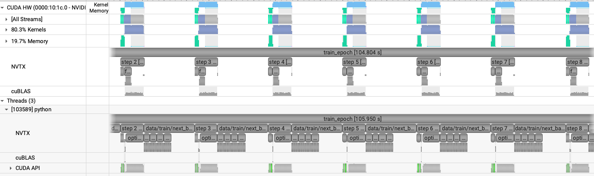
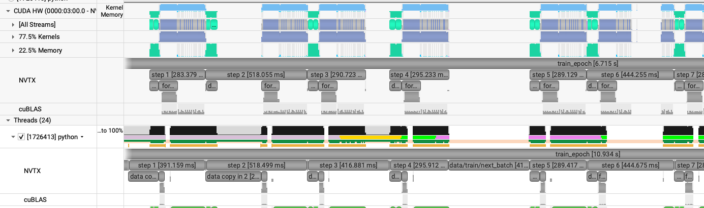
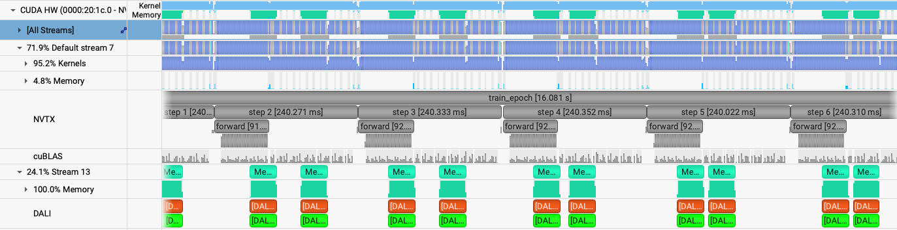

# Swin: single GPU

[Tutorial](../../README.md) · [Data parallel](data-parallel.md) · [Model parallel](model-parallel.md)

Swin attends inside shifted windows instead of across every patch. The training budget matches the [ViT single-GPU page](../vit/single-gpu.md): `embed_dim: 512`, `depth: 12`, `patch_size: 32`, global batch 4, and 64 / 16 samples. `window_size: [16, 16]` divides the 128×128 patch grid. The knobs are the same three steps. [`config/swin.yaml`](../../config/swin.yaml) holds the blocks, and [`networks/swin.py`](../../networks/swin.py) is the model.

## Profiling

`train.py` wraps the host-to-device copy, the forward, and the optimizer step in the same NVTX ranges as the ViT. A profiled config still needs at least four epochs, because the capture is the fourth epoch.

```bash
ENABLE_PROFILING=1 PROFILE_OUTPUT=swin_short \
sbatch -n 1 ./submit.sh --yaml_config ./config/swin.yaml --config short --run_num swin
```

Log: `$HOME/sc26-dl-tutorial/logs/short/1GPU/swin/out.log`. Profile: `swin_short.0.nsys-rep`.

The first three epochs look like this:

```text
2026-11-10 11:45:09,118 - root - INFO - Starting Training Loop...
2026-11-10 11:45:19,714 - root - INFO -  Memory usage after forward pass: 29.21258544921875 GB.
2026-11-10 11:45:43,344 - root - INFO - Time taken for epoch 1 is 22.755364 sec, avg 2.812524 samples/sec
2026-11-10 11:45:43,350 - root - INFO -   Avg train loss=0.453776
2026-11-10 11:45:43,355 - root - INFO -   Avg val loss=0.2938965857028961
2026-11-10 11:45:43,360 - root - INFO -   Total validation time: 3.239035129547119 sec
2026-11-10 11:45:45,009 - root - INFO -  Memory usage after forward pass: 31.39227294921875 GB.
2026-11-10 11:46:03,020 - root - INFO - Time taken for epoch 2 is 15.456323 sec, avg 4.140700 samples/sec
2026-11-10 11:46:03,025 - root - INFO -   Avg train loss=0.171803
2026-11-10 11:46:03,035 - root - INFO -   Avg val loss=0.20057116448879242
2026-11-10 11:46:03,041 - root - INFO -   Total validation time: 2.2224948406219482 sec
2026-11-10 11:46:04,696 - root - INFO -  Memory usage after forward pass: 31.39227294921875 GB.
2026-11-10 11:46:22,699 - root - INFO - Time taken for epoch 3 is 15.448804 sec, avg 4.142716 samples/sec
2026-11-10 11:46:22,705 - root - INFO -   Avg train loss=0.127628
2026-11-10 11:46:22,715 - root - INFO -   Avg val loss=0.17503631114959717
2026-11-10 11:46:22,720 - root - INFO -   Total validation time: 2.219019889831543 sec
```

Recorded performance, leaving out epoch 1 and the profiled epoch:

- GPU memory: 31.392 GB peak.
- Throughput: 4.14 samples/sec.

The profiled epoch is mostly idle. Each step is a short burst of GPU work, and the gap before the next step is wider than the step itself.



## Workers, BF16, fused Adam, and `torch.compile`

`short_opt` turns on the same four changes as the ViT, except the worker count. The ViT uses 2 workers. Swin needs 4. BF16, fused Adam, and `torch.compile` are unchanged.

```bash
ENABLE_PROFILING=1 PROFILE_OUTPUT=swin_short_opt \
sbatch -n 1 ./submit.sh --yaml_config ./config/swin.yaml --config short_opt --run_num swin_opt
```

Log: `$HOME/sc26-dl-tutorial/logs/short_opt/1GPU/swin_opt/out.log`. Profile: `swin_short_opt.0.nsys-rep`.

The first epoch pays for `torch.compile`. The next two are the steady rate:

```text
2026-11-10 11:46:02,097 - root - INFO - Starting Training Loop...
2026-11-10 11:46:46,957 - root - INFO -  Memory usage after forward pass: 19.05438232421875 GB.
2026-11-10 11:46:58,189 - root - INFO - Time taken for epoch 1 is 22.123362 sec, avg 2.892869 samples/sec
2026-11-10 11:46:58,194 - root - INFO -   Avg train loss=0.463530
2026-11-10 11:46:58,205 - root - INFO -   Avg val loss=0.3136071264743805
2026-11-10 11:46:58,210 - root - INFO -   Total validation time: 4.001360893249512 sec
2026-11-10 11:47:03,049 - root - INFO -  Memory usage after forward pass: 21.11297607421875 GB.
2026-11-10 11:47:14,849 - root - INFO - Time taken for epoch 2 is 10.984254 sec, avg 5.826522 samples/sec
2026-11-10 11:47:14,855 - root - INFO -   Avg train loss=0.190715
2026-11-10 11:47:14,865 - root - INFO -   Avg val loss=0.22433295845985413
2026-11-10 11:47:14,865 - root - INFO -   Total validation time: 3.758100986480713 sec
2026-11-10 11:47:19,347 - root - INFO -  Memory usage after forward pass: 21.11297607421875 GB.
2026-11-10 11:47:31,291 - root - INFO - Time taken for epoch 3 is 11.024850 sec, avg 5.805068 samples/sec
2026-11-10 11:47:31,296 - root - INFO -   Avg train loss=0.139245
2026-11-10 11:47:31,307 - root - INFO -   Avg val loss=0.18777012825012207
2026-11-10 11:47:31,312 - root - INFO -   Total validation time: 3.4977035522460938 sec
```

Recorded performance, leaving out epoch 1 and the profiled epoch:

- GPU memory: 21.113 GB peak, down from 31.392 GB in the FP32 baseline.
- Throughput: 5.82 samples/sec, up from 4.14 samples/sec.

BF16 shortens the GPU work, and the gaps shrink with it. They are still there. Window attention is a much shorter step than the ViT forward, so even with 4 workers, instead of the ViT's 2, the host load between steps still shows up.



## NVIDIA DALI

`short_opt_dali` keeps those four settings and switches the loader to DALI.

```bash
ENABLE_PROFILING=1 PROFILE_OUTPUT=swin_short_opt_dali \
sbatch -n 1 ./submit.sh --yaml_config ./config/swin.yaml --config short_opt_dali --run_num swin_dali
```

Log: `$HOME/sc26-dl-tutorial/logs/short_opt_dali/1GPU/swin_dali/out.log`. Profile: `swin_short_opt_dali.0.nsys-rep`.

The first epoch still pays for `torch.compile`. The next two are the steady rate:

```text
2026-11-10 11:50:01,612 - root - INFO - Starting Training Loop...
2026-11-10 11:50:26,871 - root - INFO -  Memory usage after forward pass: 24.60125732421875 GB.
2026-11-10 11:50:35,795 - root - INFO - Time taken for epoch 1 is 13.695464 sec, avg 4.381012 samples/sec
2026-11-10 11:50:35,800 - root - INFO -   Avg train loss=0.472994
2026-11-10 11:50:35,811 - root - INFO -   Avg val loss=0.307951420545578
2026-11-10 11:50:35,821 - root - INFO -   Total validation time: 2.3679275512695312 sec
2026-11-10 11:50:36,222 - root - INFO -  Memory usage after forward pass: 26.65985107421875 GB.
2026-11-10 11:50:45,592 - root - INFO - Time taken for epoch 2 is 5.104697 sec, avg 12.537472 samples/sec
2026-11-10 11:50:45,597 - root - INFO -   Avg train loss=0.192022
2026-11-10 11:50:45,607 - root - INFO -   Avg val loss=0.21398788690567017
2026-11-10 11:50:45,618 - root - INFO -   Total validation time: 2.3780429363250732 sec
2026-11-10 11:50:46,011 - root - INFO -  Memory usage after forward pass: 26.66375732421875 GB.
2026-11-10 11:50:54,933 - root - INFO - Time taken for epoch 3 is 5.146754 sec, avg 12.435023 samples/sec
2026-11-10 11:50:54,939 - root - INFO -   Avg train loss=0.133835
2026-11-10 11:50:54,949 - root - INFO -   Avg val loss=0.17917819321155548
2026-11-10 11:50:54,954 - root - INFO -   Total validation time: 1.8564786911010742 sec
```

Recorded performance, leaving out epoch 1 and the profiled epoch:

- GPU memory: 26.664 GB peak, up from 21.113 GB with the PyTorch loader. Before the first step the device is already at 7.793 GB, against 1.226 GB for `short_opt`. That increase is DALI's copy of the prefetched batches.
- Throughput: 12.49 samples/sec, up from 5.82 samples/sec.

DALI closes most of those gaps. Its kernels run on a second stream while the step is in flight, and the steps sit against each other. This is the large jump, from 5.82 to 12.49 samples/sec. 



The next page scales this step across GPUs: [Data parallelism](data-parallel.md).
