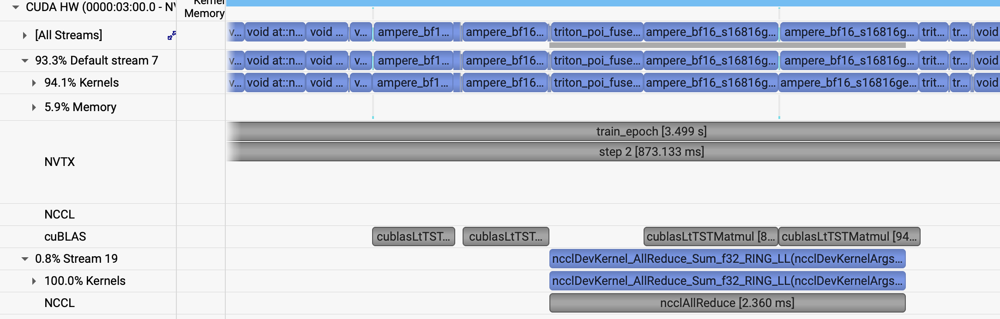

# ViT: data parallelism

[Tutorial](../../README.md) · [Single GPU](single-gpu.md) · [Model parallel](model-parallel.md)

The [single-GPU step](single-gpu.md) is in good shape. The next gain is more GPUs. Each GPU holds a full copy of the model and a different slice of the batch, and the GPUs stay in step by averaging gradients. PyTorch's `DistributedDataParallel` (DDP) does that with the NCCL backend. The [distributed package docs](https://pytorch.org/docs/stable/distributed.html) cover the collectives underneath it.

## How the job is wired

[`submit_dp.sh`](../../submit_dp.sh) starts one [`torchrun`](https://pytorch.org/docs/stable/elastic/run.html) per node, and `torchrun` starts four copies of [`train.py`](../../train.py), one process per GPU. `-N` is the number of nodes, so one node is 4 GPUs and four nodes are 16.

```bash
sbatch -N <nodes> ./submit_dp.sh --yaml_config ./config/ViT.yaml --config <name>
```

*Why one process per GPU, rather than one process per node that owns all four devices?*

DDP can form its process group in several ways. This code uses environment variables. The `torchrun` instances on the nodes rendezvous at the first node of the job (`--rdzv_endpoint`), agree on the global layout, and give each worker its `RANK`, `LOCAL_RANK`, `WORLD_SIZE`, and the master address and port. Near the bottom of `train.py`, `torch.distributed.init_process_group` reads those and brings NCCL up.

Each rank has to see its own slice of the global batch, of size `global_batch_size / world_size`. The slice is built by `DistributedSampler` in [`utils/data_loader.py`](../../utils/data_loader.py). Find that constructor and check which of `data_num_shards` and `data_shard_id` it receives.

After the network is built, `train.py` wraps it:

```python
model = DistributedDataParallel(model, device_ids=[local_rank])
```

The wrapper broadcasts the initial weights so every rank starts from the same point, and during `backward()` it all-reduces gradients in buckets so the communication overlaps the rest of the backward. The optimizer then sees one agreed-upon gradient.

*Why does DDP broadcast the initial weights? What would the replicas do if each rank kept the weights it initialized on its own?*

DDP's buckets are the reason the all-reduces show up in the middle of the backward rather than as one blob after it. The bucket size is `bucket_cap_mb` on the `DistributedDataParallel` constructor (PyTorch's default is 25 MB). A smaller bucket flushes more often, so the profile shows more, shorter, syncs.

*If the code skipped DDP and called `torch.distributed.all_reduce` on the gradients once, just before the optimizer step, where would that sync sit in the profile?*

## Scaling the batch

Hold the local batch fixed and let the global batch grow with the GPU count. A larger global batch is a less noisy gradient, so the usual companion is a larger learning rate. One rule of thumb is the square-root rule: multiply the single-GPU learning rate by `sqrt(global_batch_size / base_batch_size)`. The 4-GPU block leaves `lr` at `5e-4`. `short_opt_big_dp16` applies the rule to the large model.

*If the learning rate stays at the single-GPU value while the global batch grows, what happens to the loss curve?*

*If you raise the learning rate and leave the batch size alone, what do you expect instead?*

*As the GPU count grows, what happens to samples per second, and what happens to how fast the loss actually falls? Which scale finishes a fixed number of samples sooner, and which spends less GPU-time? Can you write a block that overfits, or one that diverges?*

Each network's file will have a data-parallel block of this shape. In [`config/ViT.yaml`](../../config/ViT.yaml) that block is `short_opt_dali_dp`: the optimized ViT, global batch 16 on 4 GPUs, so the local batch stays 4. The learning rate is still the single-GPU value, `5e-4`.

```bash
ENABLE_PROFILING=1 PROFILE_OUTPUT=vit_dp \
sbatch -N 1 ./submit_dp.sh --yaml_config ./config/ViT.yaml --config short_opt_dali_dp --run_num dp
```

The first epoch pays for `torch.compile`. Four GPUs and a global batch of 16 turn one epoch into four steps, so the same 80 iterations run for 20 epochs. Epochs 2 and 3 are the steady rate:

```text
2026-11-09 20:13:23,020 - root - INFO - Starting Training Loop...
2026-11-09 20:13:48,225 - root - INFO -  Memory usage after forward pass: 23.2166748046875 GB.
2026-11-09 20:13:55,286 - root - INFO - Time taken for epoch 1 is 12.101436 sec, avg 3.966471 samples/sec
2026-11-09 20:13:55,291 - root - INFO -   Avg train loss=0.941822
2026-11-09 20:13:55,301 - root - INFO -   Avg val loss=0.6188808679580688
2026-11-09 20:13:55,306 - root - INFO -   Total validation time: 2.533473253250122 sec
2026-11-09 20:13:56,345 - root - INFO -  Memory usage after forward pass: 24.2186279296875 GB.
2026-11-09 20:14:02,919 - root - INFO - Time taken for epoch 2 is 4.220179 sec, avg 15.165235 samples/sec
2026-11-09 20:14:02,924 - root - INFO -   Avg train loss=0.456384
2026-11-09 20:14:02,935 - root - INFO -   Avg val loss=0.4121951758861542
2026-11-09 20:14:02,940 - root - INFO -   Total validation time: 1.0587599277496338 sec
2026-11-09 20:14:03,978 - root - INFO -  Memory usage after forward pass: 24.2186279296875 GB.
2026-11-09 20:14:10,092 - root - INFO - Time taken for epoch 3 is 4.233808 sec, avg 15.116417 samples/sec
2026-11-09 20:14:10,097 - root - INFO -   Avg train loss=0.329778
2026-11-09 20:14:10,107 - root - INFO -   Avg val loss=0.3899458646774292
2026-11-09 20:14:10,117 - root - INFO -   Total validation time: 0.6728227138519287 sec
```

Recorded performance, leaving out epoch 1 and the profiled epoch:

- GPU memory: 24.219 GB peak on each GPU. The local batch is still 4, so this is close to the 25.435 GB of the one-GPU DALI run.
- Throughput: 15.11 samples/sec across 4 GPUs, up from 4.38 on one GPU.

Profile every rank. The gradient all-reduces are NCCL kernels on their own stream, issued during the backward while the GEMMs are still running on the default stream. In this step the all-reduce takes about 2.4 ms inside an 873 ms step. This all-reduce is fully overlapped with the backward compute.



## A larger model at local batch 1

Typically, as model sizes or activation sizes grow, we can drop the local batch size to keep the step fit. In `short_opt_big`, the ViT grows to `patch_size: 16` and `embed_dim: 1024`. We can drop the local batch size to 1 and keep the step fit on 4 GPUs with a global batch of 4. This is a common pattern in training larger models. 

```bash
sbatch -N 1 ./submit_dp.sh --yaml_config ./config/ViT.yaml --config short_opt_big --run_num big
```

At the last epoch the 4-GPU run is at 0.837 samples/sec.

`short_opt_big_dp16` keeps that local batch of 1 and uses 16 GPUs, so the global batch is 16. We typically do this to train faster (and on larger datasets) The learning rate follows the square-root rule, from `5e-4` to `1e-3` to compensate for the larger global batch.

```bash
sbatch -N 4 ./submit_dp.sh --yaml_config ./config/ViT.yaml --config short_opt_big_dp16 --run_num big16
```

We observe a throughput of 3.19 samples/sec and hence a larger throughout for data parallel scaling.

The next page splits the replica: [Model parallelism](model-parallel.md).
