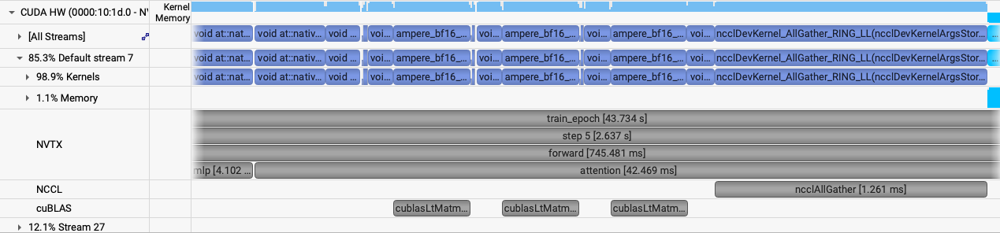
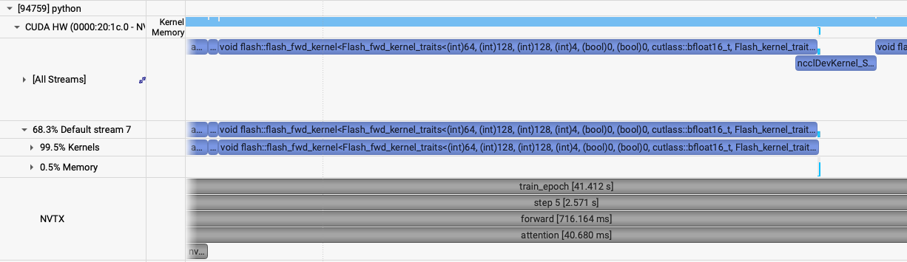
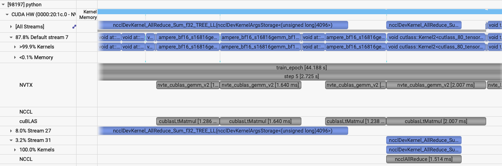

# ViT: model parallelism

[Tutorial](../../README.md) · [Single GPU](single-gpu.md) · [Data parallel](data-parallel.md)

Data parallelism still stores a full copy of the model and of the image on every GPU. At some point, as we grow the models, a local batch size of one also will not fit. `short_mp` is the next size up, `embed_dim: 1536` and `depth: 16`, with the same `patch_size: 16` and the same local batch of 1 (`global_batch_size: 4` on 4 GPUs). That step runs out of memory. Lowering the batch has nowhere left to go, so the replica itself has to be split. This is the typical way into model parallelism.

*How does patch size affect the memory usage?*
*How does embedding dimension affect the memory usage?*

Try submitting:

```bash
sbatch -N 1 --gpus-per-node 4 --cpus-per-task 48 \
    ./submit_mp.sh --yaml_config ./config/ViT.yaml --config short_mp --run_num oom \
    --tp=1 --sp1=1 --sp2=1
```

The model is built before the step fails. The log reports a local parameter count of 555.545 M.

```text
2026-11-12 02:09:52,526 - root - INFO - Local parameter count: 555.545 M
```

The forward then fails in `F.linear` inside the pointwise linear:

```text
torch.OutOfMemoryError: CUDA out of memory. Tried to allocate 768.00 MiB. GPU 1 has a total capacity of 39.49 GiB of which 760.00 MiB is free. Including non-PyTorch memory, this process has 38.74 GiB memory in use. Of the allocated memory 33.60 GiB is allocated by PyTorch, and 73.96 MiB is reserved by PyTorch but unallocated.
```

Local batch cannot be dropped further. Hence, we need to shard the model. The sharding follows the Megatron pattern: column-parallel and row-parallel linear layers, plus a spatial split of the token sequence. [Megatron-LM](https://github.com/NVIDIA/Megatron-LM/tree/main/megatron/core) is the production version of the same ideas, including [context parallelism](https://docs.nvidia.com/megatron-core/developer-guide/latest/api-guide/context_parallel.html) for a 1D token sequence. [`networks/vit_mp.py`](../../networks/vit_mp.py) shards that sequence over `sp1 × sp2`, and the heads and the MLP hidden size over `tp`. [`networks/vit_te.py`](../../networks/vit_te.py) is the same mesh from Transformer Engine layers. [`train_mp.py`](../../train_mp.py) is the training script.

## Communicator groups

Treat the allocation as an `M × D` grid. `D` GPUs replicate the model, as on the [data-parallel page](data-parallel.md), and `M` GPUs split one replica. [`utils/comm.py`](../../utils/comm.py) factors `M` further, into tensor parallelism and two spatial axes:

```text
world size = dp × tp × sp1 × sp2
```

`dp` is orthogonal to the model-parallel axes. The ViT folds `sp1 × sp2` into one context-parallel group, `sp1-sp2`.

`comm.init` asks [`utils/rank_generator.py`](../../utils/rank_generator.py) for the rank list of each group, then registers that list with `torch.distributed.new_group`. A collective takes the group it should run on:

```python
torch.distributed.all_reduce(tensor, group=comm.get_group("tp"))
```

Ranks absent from a list are not members of that group. `comm.get_group`, `comm.get_rank`, and `comm.get_size` are the lookups the layers use.

`order` chooses which index varies fastest. The default `tp-sp1-sp2-dp` makes tensor-parallel ranks a contiguous block, so they share a node. For example, eight GPUs with `tp=4` and `dp=2` give tensor-parallel groups `[0, 1, 2, 3]` and `[4, 5, 6, 7]`, and data-parallel groups `[0, 4]`, `[1, 5]`, `[2, 6]`, `[3, 7]`. Rank 5 exchanges activations inside `[4, 5, 6, 7]` and reduces data-parallel gradients with rank 1.

Only `dp` changes which sample a rank reads. [`train_mp.py`](../../train_mp.py) sizes the loader from that group, so a model-parallel group trains on one example and each rank keeps its piece of it:

```python
params.data_num_shards = comm.get_size("dp")
params.data_shard_id = comm.get_rank("dp")
```

## Autograd mappings

A layer that communicated in the forward has to communicate with the conjugate in the backward. PyTorch will not infer that pair. Each one is a `torch.autograd.Function` in [`distributed/mappings.py`](../../distributed/mappings.py): `forward` runs one collective, `backward` runs its adjoint. The modules call the wrappers (`identity_forward_allreduce_backward`, and the others below) rather than `all_reduce` directly, so both directions stay defined.

The ViT MLP is the Megatron split, as `ColumnParallelLinear` and `RowParallelLinear`.

A column-parallel layer stores a slice of the output features and sees the full input. The matmul is local, so the forward collective is an identity. On the way back, each rank holds only a partial input-gradient, and the full gradient is their sum. The layer calls `identity_forward_allreduce_backward(x, "tp")` on its input. Attention uses the same layer for the query, key, and value projections, which also splits the heads across `tp`.

A row-parallel layer stores a slice of the input features. Each matmul is a partial output and the real output is the sum, so the forward ends in `allreduce_forward_identity_backward(x, "tp")`. The output-gradient arriving in the backward is already complete, and that pass stays local. The attention projection and the second MLP matrix are row-parallel.

Sequence sharding is the same pattern on the token axis. Attention leaves the query on the local tokens and gathers keys and values over `sp1-sp2` with `allgather_forward_reducescatter_backward`. The backward reduce-scatters the key and value gradients onto the tokens that owned them. `allgather_forward_split_backward` and `split_forward_allgather_backward` are the gather/split pair for a tensor that is cut without a reduction.

A parameter that is a slice or a copy across a group carries `comm_metadata`. `init_ddp_model_and_reduction_hooks` in the same file reads it when the model is wrapped in DDP, and adds an all-reduce for any weight gradient the local backward has not already summed. A column-parallel weight, updated from this rank's tokens and copied across the spatial group, is marked:

```python
self.weight.comm_metadata = {
    "sharded": ["tp", None],
    "shared": ["sp1-sp2"],
    "reduce": ["sp1-sp2"],
}
```

`sharded` is the axis of the slice, `shared` is a group holding an identical copy, and `reduce` is that extra all-reduce.

*If a weight is shared across a model-parallel group, what has to be true of its initialization, and of its gradient?*

Shared weights must be initialized identically on every rank that holds them. If the backward only saw this rank's tokens, the weight gradient is a partial sum and needs the extra all-reduce named in `reduce`. DDP's own all-reduce covers the data-parallel copies. It does not cover that spatial sum. `init_ddp_model_and_reduction_hooks` registers it. In general, if weights are shared across any group and it receives a split gradient, it needs the extra all-reduce.

## Transformer Engine

When the network really is a stack of attention and MLP blocks on a 1D token sequence, [Transformer Engine](https://docs.nvidia.com/deeplearning/transformer-engine/api/pytorch.html) can own the sharding. The ViT flattens its patches into that kind of sequence, so [`networks/vit_te.py`](../../networks/vit_te.py) is a thin wrapper: pass the tensor-parallel group, and say whether the layer is column-parallel or row-parallel. TE shards the weight, inserts the matching collective, and fuses the epilogue.

```python
self.fc1 = te.Linear(
    in_features,
    hidden_features,
    bias=True,
    sequence_parallel=False,
    tp_group=comm.get_group("tp"),
    tp_size=comm.get_size("tp"),
    parallel_mode="column",
    device=torch.cuda.current_device(),
)
```

The [Linear signature](https://docs.nvidia.com/deeplearning/transformer-engine/api/pytorch.html) lists the rest of the arguments. Self-attention is `te.DotProductAttention`. The heads are the tensor-parallel axis. See the call in [`networks/vit_te.py`](../../networks/vit_te.py). The [attention signature](https://docs.nvidia.com/deeplearning/transformer-engine/api/pytorch.html) is the reference.

Set `model_backend: transformer-engine` to select this path. TE's context parallelism wants an even local sequence, and `vit_te.py` pads when the `sp1 × sp2` split is uneven. In a profile, TE's own NVTX ranges wrap each linear and the all-reduce that follows the row-parallel one. The column-parallel linear has no forward collective.

## Running a model-parallel job

[`submit_mp.sh`](../../submit_mp.sh) starts one `torchrun` per node, which runs [`train_mp.py`](../../train_mp.py) on all eight GPUs, one process per GPU. The single-node examples request four GPUs with `--gpus-per-node 4`, and `torchrun` starts four processes to match. `dp` is whatever GPUs remain.

```text
--tp      tensor-parallel size
--sp1     first spatial axis
--sp2     second spatial axis
--order   rank order, default tp-sp1-sp2-dp
```

```bash
sbatch --nodes=<nodes> ./submit_mp.sh \
    --yaml_config ./config/<file>.yaml --config <name> \
    --tp=1 --sp1=4 --sp2=1
```

For the ViT that ran out of memory, use 2 nodes, 16 GPUs. `sp1=4` shards the token sequence inside each node, and each 8-GPU node holds two of those groups. The global batch of 4 is split over `dp=4`, so the local batch stays 1.

```bash
ENABLE_PROFILING=1 PROFILE_OUTPUT=vit_mp \
sbatch -N 2 ./submit_mp.sh --yaml_config ./config/ViT.yaml --config short_mp --run_num mp \
    --tp=1 --sp1=4 --sp2=1
```

Log: `$HOME/sc26-dl-tutorial/logs/short_mp/4MP/mp/out.log`. Profiles: `vit_mp.0.nsys-rep` through `vit_mp.15.nsys-rep`.

`sp1=4` brings the local parameter count to 480.048 M. The first three epochs stay under 40 GB. Epoch 4 is the profiled epoch.

```text
2026-11-12 02:11:39,113 - root - INFO - Starting Training Loop...
2026-11-12 02:11:44,897 - root - INFO -  Memory usage after forward pass: 34.01580810546875 GB.
2026-11-12 02:12:27,901 - root - INFO - Time taken for epoch 1 is 40.834481 sec, avg 1.469346 samples/sec
2026-11-12 02:12:27,912 - root - INFO -   Avg train loss=0.572400
2026-11-12 02:12:27,922 - root - INFO -   Avg val loss=0.3583354353904724
2026-11-12 02:12:27,927 - root - INFO -   Total validation time: 1.4751899242401123 sec
2026-11-12 02:12:30,941 - root - INFO -  Memory usage after forward pass: 36.17791748046875 GB.
2026-11-12 02:13:16,589 - root - INFO - Time taken for epoch 2 is 43.178823 sec, avg 1.482208 samples/sec
2026-11-12 02:13:16,599 - root - INFO -   Avg train loss=0.300683
2026-11-12 02:13:16,605 - root - INFO -   Avg val loss=0.33952224254608154
2026-11-12 02:13:16,610 - root - INFO -   Total validation time: 2.2306969165802 sec
2026-11-12 02:13:19,659 - root - INFO -  Memory usage after forward pass: 36.36541748046875 GB.
2026-11-12 02:14:05,387 - root - INFO - Time taken for epoch 3 is 42.996899 sec, avg 1.488479 samples/sec
2026-11-12 02:14:05,397 - root - INFO -   Avg train loss=0.290804
2026-11-12 02:14:05,413 - root - INFO -   Avg val loss=0.33401578664779663
2026-11-12 02:14:05,423 - root - INFO -   Total validation time: 2.2465858459472656 sec
```

Recorded performance, leaving out the profiled epoch:

- GPU memory: 36.366 GB peak after the forward pass.
- Throughput: 1.48 samples/sec across 16 GPUs, with local batch 1.

Attention keeps the query on this rank's tokens and all-gathers the keys and values over `sp1-sp2` before the score. In the profile that gather is `ncclDevKernel_AllGather` on the default stream, about 1.3 ms, between the BF16 GEMMs of the forward.



`short_mp_te` is that same model with `model_backend: transformer-engine`. The mesh is unchanged: `sp1=4` shards the sequence inside the node, and `dp=4` keeps the local batch at 1. `NVTE_BATCH_MHA_P2P_COMM=1` batches the context-parallel K/V send and recv.

```bash
NVTE_BATCH_MHA_P2P_COMM=1 \
ENABLE_PROFILING=1 PROFILE_OUTPUT=vit_mp_te \
sbatch -N 2 ./submit_mp.sh --yaml_config ./config/ViT.yaml --config short_mp_te --run_num mp_te \
    --tp=1 --sp1=4 --sp2=1
```

Log: `$HOME/sc26-dl-tutorial/logs/short_mp_te/4MP/mp_te/out.log`. Profiles: `vit_mp_te.0.nsys-rep` through `vit_mp_te.15.nsys-rep`.



The same config with tensor parallelism leaves the sequence whole. `tp=4` shards the heads and the MLP across four GPUs within a node. `1536` and the 24 heads divide by 4. Two nodes leave `dp=4`, so the local batch stays 1. `CUDA_DEVICE_MAX_CONNECTIONS=1` keeps the backward all-reduce ahead of the weight-gradient GEMM so the two overlap.

```bash
CUDA_DEVICE_MAX_CONNECTIONS=1 \
ENABLE_PROFILING=1 PROFILE_OUTPUT=vit_mp_te_tp \
sbatch -N 2 ./submit_mp.sh --yaml_config ./config/ViT.yaml --config short_mp_te --run_num mp_te_tp \
    --tp=4 --sp1=1 --sp2=1
```

Log: `$HOME/sc26-dl-tutorial/logs/short_mp_te/4MP/mp_te_tp/out.log`. Profiles: `vit_mp_te_tp.0.nsys-rep` through `vit_mp_te_tp.15.nsys-rep`.



Look for that overlap in the two profiles. In the sequence-sharded run it is the K/V P2P (`ncclDevKernel_SendRecv`) beside the flash-attention kernel. In the tensor-parallel run it is the backward all-reduce of the input gradient beside the weight-gradient GEMM.


*Which activations does a spatial split leave replicated on every rank? Which weights does tensor parallelism leave replicated? On this model, which of those two splits moves less data per step?*

*Try out other mesh sizes*

*Try out configs with different patch sizes or model sizes*

Picking `dp`, `tp`, and `sp1`/`sp2`, and which of them sits on the fast links inside a node, depends on how much each collective moves and on the machine. The usual tool for that choice is a performance model. [Performance models for transformers in science](https://arxiv.org/abs/2410.00273) works through one.

## Activation checkpointing

Activation checkpointing is an alternative that leaves the replica whole. `short_mp_ckpt` is the out-of-memory model with `activation_checkpoint: true`. Each block keeps its input, and the backward recomputes the block. One node, with tensor and spatial parallelism off:

```bash
sbatch -N 1 --gpus-per-node 4 --cpus-per-task 48 \
    ./submit_mp.sh --yaml_config ./config/ViT.yaml --config short_mp_ckpt --run_num ckpt \
    --tp=1 --sp1=1 --sp2=1
```

Log: `$HOME/sc26-dl-tutorial/logs/short_mp_ckpt/1MP/ckpt/out.log`. Profiling stays off.

The step is much slower, because every block runs again in the backward. A slower step can also cost more GPU hours than splitting the same model across more GPUs. There is a floor. The checkpoint still stores the weights, the input to each block, and the activations of the block being recomputed. Grow the model past that remainder and checkpointing cannot make the step fit.

*Try this run. What do you see for memory after the forward, and for samples per second?*

## CUDA graphs (optional)

[`train_mp_graphs.py`](../../train_mp_graphs.py) captures the training step in a CUDA graph and replays it. A graph removes the CPU launch gap between kernels. That gap matters when a step is many small launches, and when several communicators have to stay in lockstep: the CPU jitter shows up as ranks waiting on each other. [`submit_mp.sh`](../../submit_mp.sh) calls [`train_mp.py`](../../train_mp.py). Compare the two scripts for where the graph is captured and where it is replayed.
