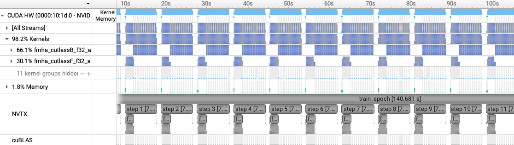
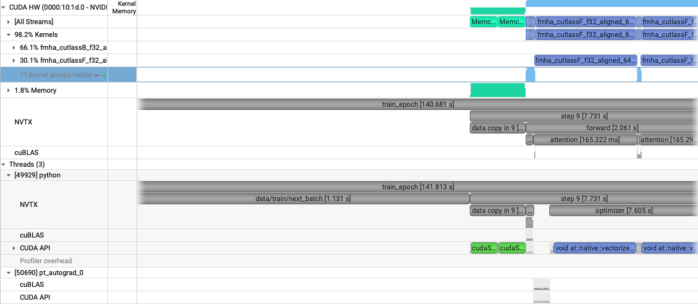
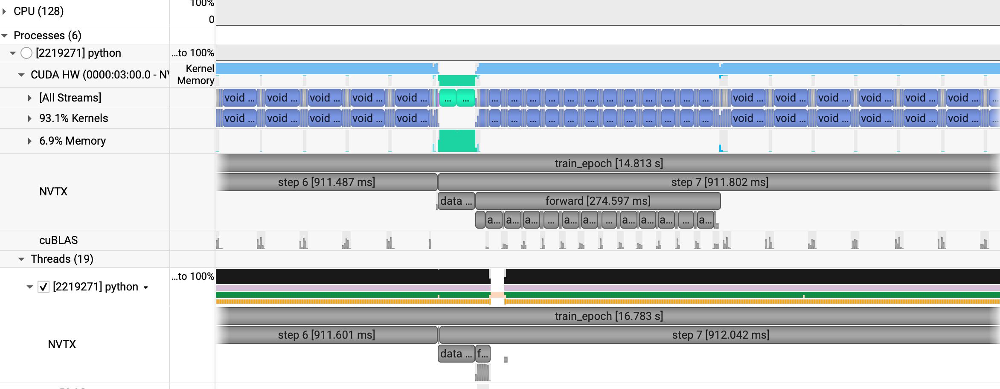
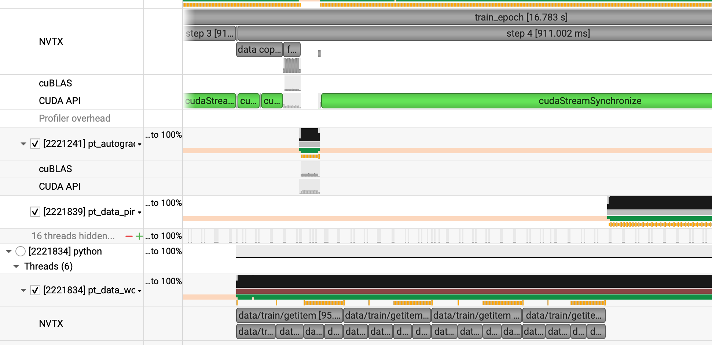
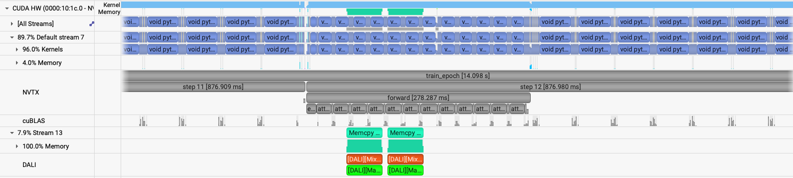

# ViT: single GPU

[Tutorial](../../README.md) · [Data parallel](data-parallel.md) · [Model parallel](model-parallel.md)

The baseline leaves the GPU idle while a 4096 × 4096 batch is read, and it runs the step in FP32. Profile that run first. The next run, `short_opt`, turns on data workers, BF16, fused Adam, and `torch.compile` together. `short_opt_dali` then swaps in the DALI loader. The knobs are keys in the YAML block. [`config/ViT.yaml`](../../config/ViT.yaml) gathers them, and the other network files will get the same pair.

## Profiling

`train.py` already wraps the host-to-device copy, the forward, and the optimizer step in NVTX ranges (`torch.cuda.nvtx.range`), and it calls `torch.cuda.profiler.start()` and `stop()` around the fourth epoch. The ranges are what label the timeline. The profiler calls are what limit the capture to that epoch, so a profiled config needs at least four epochs. Grep `train.py` for `nvtx` and `profiler` to see the calls.

This profiled baseline is the first job to run in the tutorial which should have been submitted after the setup:

```bash
ENABLE_PROFILING=1 PROFILE_OUTPUT=vit_short \
sbatch -n 1 ./submit.sh --yaml_config ./config/ViT.yaml --config short --run_num short
```

Log: `$HOME/sc26-dl-tutorial/logs/short/1GPU/short/out.log`. Profile: `vit_short.0.nsys-rep`.

The first three epochs look like this:

```text
2026-11-12 00:11:08,885 - root - INFO - Starting Training Loop...
2026-11-12 00:11:27,656 - root - INFO -  Memory usage after forward pass: 28.73382568359375 GB.
2026-11-12 00:13:52,268 - root - INFO - Time taken for epoch 1 is 143.056369 sec, avg 0.447376 samples/sec
2026-11-12 00:13:52,279 - root - INFO -   Avg train loss=0.468649
2026-11-12 00:13:52,289 - root - INFO -   Avg val loss=0.33273956179618835
2026-11-12 00:13:52,294 - root - INFO -   Total validation time: 7.693940162658691 sec
2026-11-12 00:14:02,725 - root - INFO -  Memory usage after forward pass: 30.91351318359375 GB.
2026-11-12 00:16:26,789 - root - INFO - Time taken for epoch 2 is 141.962560 sec, avg 0.450823 samples/sec
2026-11-12 00:16:26,800 - root - INFO -   Avg train loss=0.200263
2026-11-12 00:16:26,810 - root - INFO -   Avg val loss=0.23314695060253143
2026-11-12 00:16:26,820 - root - INFO -   Total validation time: 7.683780670166016 sec
2026-11-12 00:16:37,131 - root - INFO -  Memory usage after forward pass: 30.91351318359375 GB.
2026-11-12 00:19:01,057 - root - INFO - Time taken for epoch 3 is 141.733836 sec, avg 0.451551 samples/sec
2026-11-12 00:19:01,068 - root - INFO -   Avg train loss=0.144453
2026-11-12 00:19:01,073 - root - INFO -   Avg val loss=0.19404181838035583
2026-11-12 00:19:01,083 - root - INFO -   Total validation time: 7.688852548599243 sec
```

Recorded performance:

- GPU memory: 30.914 GB peak.
- Throughput: 0.450 samples/sec on average.

The script wraps the process in `nsys profile` and writes `vit_short.<rank>.nsys-rep` under the log directory. `--trace=cuda,nvtx` keeps the trace to CUDA and the ranges we added. `-c cudaProfilerApi` tells Nsight to record only the stretch between `profiler.start` and `profiler.stop`. Copy the report back and open it in the Nsight Systems install from [Setup](../../README.md#setup). The same prefix works on the later job scripts.

Zoomed out, the timeline has idle gaps between steps. Those gaps are the data load, which the next section closes.



Zoomed into one step, the host read of the next batch finishes before the GPU work starts. The step itself is mostly the forward and the attention GEMMs.



## Workers, BF16, fused Adam, and `torch.compile`

`short_opt` is the same short ViT with four changes turned on together.

[`utils/data_loader.py`](../../utils/data_loader.py) already sets `pin_memory`. That stages the batch in pinned host memory, which raises the bandwidth of the copy onto the GPU. The knob left open in the baseline is `num_data_workers`. At `0`, which is also PyTorch's default, the training process itself reads the next batch. On a 4096 × 4096 field that read is long enough to show up as the gap in the baseline profile. `short_opt` sets it to 2. Worker processes read ahead of the step and hide that cost. A few workers, typically somewhere from 2 to 8, is enough. Past that the workers contend with the training process and throughput turns down.

Workers remove the gap between steps. The copy of the batch onto the GPU is still on the same CUDA stream as the compute, so it still sits at the front of the step. Prefetching that copy on its own stream is possible in plain PyTorch. A worked example is the [prefetching loader in NVIDIA's ConvNet examples](https://github.com/NVIDIA/DeepLearningExamples/blob/41f582bd9f65f6ebede77532b7cd64f038a8a380/PyTorch/Classification/ConvNets/image_classification/dataloaders.py#L354). DALI does that overlap in the next section.

The baseline step is FP32. Automatic mixed precision (AMP) runs the eligible ops in FP16 or BF16 and keeps the rest in FP32, which turns on tensor cores. `train.py` uses two pieces from `torch.amp`. `autocast` picks the dtype of each op. `GradScaler` scales the loss so FP16 gradients, which have a narrow range, do not underflow. BF16 has the same exponent range as FP32, so BF16 needs no loss scaling. `amp_mode: bf16` is the setting used here. `amp_mode: fp16` is the path that turns the scaler on. 

Tensor cores are already in use for FP32 GEMMs through TF32, which PyTorch enables by default for cuDNN and cuBLAS. `NVIDIA_TF32_OVERRIDE=0` turns TF32 off. The baseline should slow down. TF32 only changes the math inside the kernel. The activations and weights stay FP32, so the traffic to memory is unchanged. FP16 and BF16 cut that traffic as well as the math, which is why AMP still wins on top of TF32. The forward and the backward both shrink, because these networks spend their time in GEMMs.

`enable_fused: true` selects the fused Adam implementation in `torch.optim.Adam`. That update used to live in [APEX](https://github.com/NVIDIA/apex). It is in PyTorch now. One kernel applies the moment updates and the weight write, instead of a chain of small kernels, which cuts launch latency and keeps the values in registers.

`enable_jit: true` wraps the model in `torch.compile`, which fuses the elementwise ops around those GEMMs. Because the step is dominated by large GEMMs, fusing the surrounding kernels is a smaller win than AMP, and it still shows up. 

Run this:

```bash
ENABLE_PROFILING=1 PROFILE_OUTPUT=vit_short_opt \
sbatch -n 1 ./submit.sh --yaml_config ./config/ViT.yaml --config short_opt --run_num short_opt
```

The first epoch pays for `torch.compile`. The next two are the steady rate:

```text
2026-11-12 00:41:05,073 - root - INFO - Starting Training Loop...
2026-11-12 00:41:36,707 - root - INFO -  Memory usage after forward pass: 18.88031005859375 GB.
2026-11-12 00:41:57,886 - root - INFO - Time taken for epoch 1 is 25.893926 sec, avg 2.471622 samples/sec
2026-11-12 00:41:57,897 - root - INFO -   Avg train loss=0.462643
2026-11-12 00:41:57,907 - root - INFO -   Avg val loss=0.3145856261253357
2026-11-12 00:41:57,917 - root - INFO -   Total validation time: 4.084561824798584 sec
2026-11-12 00:42:01,435 - root - INFO -  Memory usage after forward pass: 19.88031005859375 GB.
2026-11-12 00:42:22,641 - root - INFO - Time taken for epoch 2 is 17.670814 sec, avg 3.621791 samples/sec
2026-11-12 00:42:22,651 - root - INFO -   Avg train loss=0.183656
2026-11-12 00:42:22,667 - root - INFO -   Avg val loss=0.2188115119934082
2026-11-12 00:42:22,677 - root - INFO -   Total validation time: 4.007168292999268 sec
2026-11-12 00:42:26,175 - root - INFO -  Memory usage after forward pass: 19.88031005859375 GB.
2026-11-12 00:42:47,391 - root - INFO - Time taken for epoch 3 is 17.673452 sec, avg 3.621251 samples/sec
2026-11-12 00:42:47,401 - root - INFO -   Avg train loss=0.136330
2026-11-12 00:42:47,417 - root - INFO -   Avg val loss=0.18631479144096375
2026-11-12 00:42:47,427 - root - INFO -   Total validation time: 3.987053632736206 sec
```

Recorded performance, leaving out epoch 1 and the profiled epoch:

- GPU memory: 19.880 GB peak, down from 30.914 GB in the FP32 baseline.
- Throughput: 3.62 samples/sec, up from 0.450 samples/sec.

We see a significant improvement in throughput, and a reduction in GPU memory usage compared to the FP32 baseline.

The profiled epoch is a run of steps a little under a second each. The forward is about 274 ms, against a step of about 7.7 s in the FP32 baseline. A short host-to-device copy still sits between steps.



Zooming in shows the data-loader workers. Their `data/train/getitem` ranges run while the GPU is still in the training step. The copy onto the GPU stays on the main process, at the front of the next step.



## NVIDIA DALI

Two costs in the PyTorch loader stay even after the worker count is tuned.

1. I/O and any augmentation run as CPU work.
2. The workers are processes. Spawning and talking to them costs more than threads.

[DALI](https://docs.nvidia.com/deeplearning/dali/user-guide/docs/) is the loader in [`utils/data_loader_dali.py`](../../utils/data_loader_dali.py), selected with `data_loader_config: dali`.

1. Its pipeline can run augmentation on the GPU.
2. Its workers are threads in the C++ runtime, so the prefetch keeps up with the step.

In the timeline, DALI shows up as extra CUDA streams beside the PyTorch stream. Those streams move the next batch, and run DALI's own kernels, while the current step is still computing. That overlap is the gain over the native loader on a field this large. `short_opt_dali` keeps the BF16, fused Adam, and `torch.compile` settings from `short_opt`.

```bash
ENABLE_PROFILING=1 PROFILE_OUTPUT=vit_short_opt_dali \
sbatch -n 1 ./submit.sh --yaml_config ./config/ViT.yaml --config short_opt_dali --run_num dali
```

The first epoch still pays for `torch.compile`. The next two are the steady rate:

```text
2026-11-12 01:03:20,656 - root - INFO - Starting Training Loop...
2026-11-12 01:03:39,572 - root - INFO -  Memory usage after forward pass: 24.42913818359375 GB.
2026-11-12 01:03:58,193 - root - INFO - Time taken for epoch 1 is 21.396088 sec, avg 2.804251 samples/sec
2026-11-12 01:03:58,203 - root - INFO -   Avg train loss=0.477388
2026-11-12 01:03:58,218 - root - INFO -   Avg val loss=0.3031325340270996
2026-11-12 01:03:58,229 - root - INFO -   Total validation time: 2.7410261631011963 sec
2026-11-12 01:03:59,357 - root - INFO -  Memory usage after forward pass: 25.43304443359375 GB.
2026-11-12 01:04:17,862 - root - INFO - Time taken for epoch 2 is 15.180354 sec, avg 4.215975 samples/sec
2026-11-12 01:04:17,872 - root - INFO -   Avg train loss=0.184022
2026-11-12 01:04:17,888 - root - INFO -   Avg val loss=0.20754294097423553
2026-11-12 01:04:17,898 - root - INFO -   Total validation time: 1.6718838214874268 sec
2026-11-12 01:04:19,032 - root - INFO -  Memory usage after forward pass: 25.43304443359375 GB.
2026-11-12 01:04:37,394 - root - INFO - Time taken for epoch 3 is 15.186325 sec, avg 4.214318 samples/sec
2026-11-12 01:04:37,404 - root - INFO -   Avg train loss=0.129656
2026-11-12 01:04:37,420 - root - INFO -   Avg val loss=0.1751786470413208
2026-11-12 01:04:37,430 - root - INFO -   Total validation time: 1.527073860168457 sec
```

Recorded performance, leaving out epoch 1 and the profiled epoch:

- GPU memory: 25.433 GB peak, up from 19.880 GB with the PyTorch loader. Before the first step the device is already at 7.712 GB, against 1.146 GB for `short_opt`. That increase is DALI's copy of the prefetched batches.
- Throughput: 4.21 samples/sec, up from 3.62 samples/sec.

DALI's copy and its own kernels run on a second CUDA stream while the default stream is still inside the current step. The forward is about 278 ms, and each step is about 877 ms.



The next page scales this step across GPUs: [Data parallelism](data-parallel.md).
